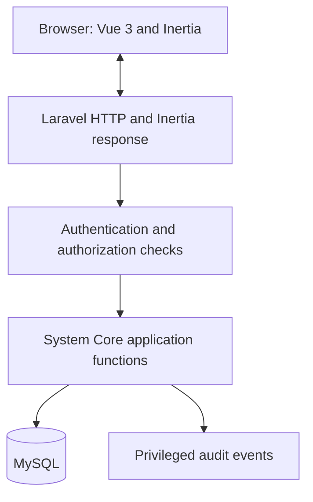

# DOC-008 | KUTMB HR System Core Solution Architecture

> **Architecture baseline:** v0.1 DRAFT · 29 Oktober 2026  
> **Confirmed stack families by technical requestor:** Laravel + Vue + MySQL  
> **Proposed versions and integration:** Laravel 13, Vue 3, Inertia.js 3, TypeScript, Vite, MySQL 8.4 LTS  
> **Approval:** Architecture review pending. No code has been implemented or tested.  
> **Structure freeze:** **NOT ALLOWED**. Physical folder layout, module boundaries in code, deployment topology and detailed database schema will be discussed later.

## 1. Scope and authority

This architecture applies to **System Core** only. MOD-001 (User Management & Identity Access) is the first implementation target, MOD-002 (Configuration) is supporting, and MOD-003 (Security/Audit) is cross-cutting. **HR Core MOD-004..MOD-011 remains on hold** awaiting official HR domain requirements. See [SCOPE-001](../decisions/SCOPE-001_system-core-vs-hr-core.md).

This is a **planning proposal**. Only the stack families Laravel, Vue and MySQL have been directed for the project. Versions, integration approach and security controls below are technical recommendations to review; they are not an HR business requirement, procurement decision or approval to start deployment.

## 2. Architecture decision: modern Laravel monolith

**Preferred:** Laravel (server-side routing, business validation, authorization, session, orchestration) + **Inertia 3** (Laravel ↔ Vue page bridge) + **Vue 3** (page UI using Single-File Components / Composition API) + **MySQL** (persisted system data).

**Why:** One application-origin and one session/security boundary, no separately deployed API gateway, reduced operational and conceptual load for a Laravel-experienced developer learning Vue. Backend remains the policy enforcement point. Official Laravel 13 Vue starter kit already uses Inertia 3 and Vue 3/TypeScript.

**Defer by default:** separate standalone Vue SPA, REST API for normal browser pages, JWT/browser bearer tokens, extra global store (Pinia), SSR runtime, WebSockets and external SSO. Add only if an accepted requirement or measurable problem justifies them.

**Session:** use Laravel's browser session authentication with secure, HTTP-only, SameSite cookies, server-side session invalidation, CSRF protection and session rotation on login. Avoid access/refresh tokens stored in localStorage. Review proxy / domain / HTTPS configuration before production. If future third-party/mobile API is approved, make a **separate API design review** and evaluate Sanctum or other appropriate mechanisms, not an automatic browser auth replacement.

## 3. Technical choices matrix

| Item | Preferred baseline | Decision status | Reason / constraint |
|---|---|---|---|
| Backend | Laravel 13 | PROPOSED VERSION; FAMILY CONFIRMED | Familiar platform for auth, policies, validation and testing |
| Frontend | Vue 3 SFC + Composition API + `<script setup>` | PROPOSED VERSION/PATTERN; FAMILY CONFIRMED | Current Vue recommended full-application pattern |
| Frontend typing | TypeScript (starter-default; adopt incrementally) | PROPOSED | Safer page prop/form contracts; add focused learning rather than write untyped code everywhere |
| Laravel–Vue bridge | Inertia.js 3 | PREFERRED / REVIEW REQUIRED | Single repo, server routing and session integration |
| Assets | Vite | PROPOSED | Laravel-supported build flow |
| Design system | Accessible base controls; Tailwind/shadcn-vue as starter references | OPTIONAL / NOT FROZEN | Avoid complex animations and unnecessary UI dependencies |
| Data store | MySQL; 8.4 LTS as conservative proposed baseline | FAMILY CONFIRMED, VERSION PROPOSED | LTS stability; check hosting/connector support before pin |
| Login principal | Unique username, independent of employee record | DESIGN DEFAULT / REVIEW REQUIRED | Avoid staff ID/email coupling; validate username normalization and uniqueness |
| Email | Optional account contact, not implicitly verified or functional reset channel | OPEN | Depends on actual SMTP/email/recovery setup |
| SSO | None in first baseline | DEFERRED | External identity provider not requested |
| SSR | Off / not provisioned for System Core initially | PROPOSED | Login/admin pages have no search-engine indexing requirement |
| Queue/cache | Framework standard; backend/driver deferred | NOT FROZEN | Approve operational requirement before selecting Redis/services |
| Docker | Recommended for isolated local development | PROPOSED | Specific volumes/services/Compose topology not yet approved |
| Source layout | **UNDECIDED** | EXPLICITLY DEFERRED | Dedicated file structure discussion requested |

**Important distinction:** Selecting a starter kit does not mean exposing its default public registration or all authentication features. Disable unapproved self-registration; test every enabled identity flow.

## 4. Module responsibilities and dependencies

| Module | Business responsibility | Must-have boundaries | Phase |
|---|---|---|---|
| MOD-001 User Management & IAM | Account creation, access lifecycle, login/logout, roles, permissions, own profile | No employee record requirement; no public self-registration unless approved | First |
| MOD-003 Security/Audit | Session restrictions, protected operations, privileged audit and safe error behavior | Consumed by MOD-001; not postponed until an unrelated phase | With MOD-001 |
| MOD-002 System Configuration & Reference Data | Shared non-sensitive, approved system settings and lookup maintenance | Only minimum configuration needed for MOD-001 initially; `panggilan` meaning still open | Next/limited |
| MOD-004..011 HR Core | Employee, organisation, leave, payroll and other HR workflows | **HOLD** until HR requirement baseline and owner approval | Future |

No speculative HR entity or column is included in the first build. User identifiers are opaque and stable; future relationship between account and employee is explicitly deferred.

## 5. Security trust boundary

**Never trust Vue UI as an authorization boundary.**

- Vue form validation is for convenience only; Laravel validates every mutation again.
- Inertia shared props must include **minimal, explicitly selected** user/permission display information, not whole model rows, tokens or privileged config.
- HTTP middleware, authorization policies and permission checks must apply to actual protected operations, even when buttons are hidden.
- Enforce per-record/per-target authorization: role ownership, privilege hierarchy, self-escalation and ID enumeration risks.
- Use secure database queries/bindings and Eloquent validation; do not build raw SQL from untrusted input.
- No rendering of untrusted HTML using Vue `v-html`; never treat untrusted text as a Vue template.
- Keep errors generic for authentication and sensitive failures; production errors do not expose stack traces.
- Design privileged audit events with minimal metadata, restricted readers and separately approved retention.
- Verify backup **and restore** using synthetic data prior to production.
- Protect secret storage, least-privilege DB credentials and deployment build chain; no secrets or HR data in Git.

The full proposed verification controls are in [System Core Security Baseline](../security/SEC-001_System_Core_Security_Baseline_v0.1_DRAFT.md). **OWASP ASVS 5.0** is a reference framework, not a claim of compliance.

## 6. Authentication and provisioning defaults for review

1. **Prefer username** as login principal (not an employee ID). Avoid email requirement unless contact/recovery decisions justify it.
2. First System Admin shall be bootstrapped through a **protected, explicitly authorized, one-time process**. No hardcoded permanent admin credentials or default password.
3. New accounts created by authorized administrators only. Public registration disabled.
4. Initial credential delivery and password reset **MUST remain unspecified** until secure supported channels have been reviewed. Do not send initial passwords by plain email, messaging apps or console logs.
5. The effective role/permission matrix must be reviewed before user admin access is granted. Privileged accounts should use MFA subject to approved deployment/identity policies.
6. Deactivate = deny next protected operation and revoke live session privileges. Protect final System Admin atomically.
7. Administrative privilege changes are auditable; never expose password, reset link or 2FA secret in audit data.

**Status:** proposed defaults. Existing `UM-DEC-001..012` remain open until their owners resolve them. The [DOC-011 Functional Design](../design/DOC-011_MOD-001_Functional_Design_v0.1_DRAFT.md) is consolidated into this review branch from Draft PR #1; it remains DRAFT and DOC-008 does not supersede its normative inputs.

## 7. Data architecture (logical only)

Initial conceptual entities: `User`, `Role`, `Permission`, `UserRole`, `RolePermission`, `Session`, `AuditEvent`. **No physical schema, migration scripts, SQL index strategy, FK declaration or file path is fixed here.**

Data principles: unique canonical login ID at DB boundary; protect last-admin invariant against concurrency; safe transaction boundaries for role changes and audit; explicit role-permission catalogue; no cascade erase of audit or actor references; no customer HR dataset during development.

Database design review will specify transaction isolation, locking approach, account-state constraints, indexing, migration/backout, MySQL version-specific settings and backup strategy.

## 8. Quality and testing

**Backend:** Laravel HTTP / feature and policy tests with real MySQL integration where applicable; concurrency tests for unique login and last-admin protection.  
**Frontend:** Vue component/form tests with mocked props, accessibility checks and static TypeScript checks.  
**End-to-end:** Browser-based login, user CRUD, direct URL attack, logout/session replay, disabled session, role escalation, duplicate-user and mobile keyboard flow.  
**Security:** OWASP ASVS-informed checks, dependency and secret scans, least privilege, CSRF, XSS, mass assignment, IDOR, rate limiting and audit verification.  
**Operational:** consistent migrations, recovery dry-run with synthetic data, configuration inspection, evidence/rollback.

**Test gate:** CI pass ≠ HR sign-off. Evidence is linked to stable RTM test IDs, commit and environment; no fabricated "passed" labels.

## 9. Delivery sequence (planning, not permission to execute)

| Milestone | Deliverable | Gate |
|---|---|---|
| ARCH-01 | System Core architecture + technical decision/ADR review | Stack bridge and boundary reviewed |
| ARCH-02 | MOD-001 decisions resolved: login, profile, bootstrap, RBAC, recovery | No critical auth blockers |
| ARCH-03 | Security baseline and threat model | Privileged account/security reviewer agreement |
| ARCH-04 | User data ERD, contract and file structure workshop | **Deliberately later** |
| ARCH-05 | Starter-kit evaluation proof of concept with **synthetic** users | No HR Core scope, no secrets |
| DEV-01 | Authentication + secure admin bootstrap | Target-specific authorization tests |
| DEV-02 | User administration + RBAC + lifecycle | All negative privilege/last-admin tests |
| DEV-03 | Cross-cutting audit + session revocation | Security regression and MySQL evidence |
| DEV-04 | Final UAT & release review | All approved gates and accountable sign-off |

Do not start implementation in this architecture-only change.

## 10. Decisions requiring explicit technical review

- Inertia 3 vs standalone SPA (preferred Inertia)
- Username-only vs email login and reset/recovery channel
- RBAC permission hierarchy and admin bootstrap process
- MFA scope and authenticated session policies
- MySQL minor version, schema and concurrency design
- Test runner choices (Laravel testing, Vue tests and browser runner)
- Infrastructure topology, backup/restore, database retention and audit policy
- Physical source directory and module organization (**deferred**)
- Any need for separate API, SSO, SSR, queue or streaming

## 11. Reference links (verified 2026-10-29)

- Official Laravel 13 Vue starter kit: https://laravel.com/docs/13.x/starter-kits
- Laravel frontend/Inertia architecture: https://laravel.com/docs/13.x/frontend
- Laravel authentication and authorization: https://laravel.com/docs/13.x/authentication and https://laravel.com/docs/13.x/authorization
- Laravel CSRF: https://laravel.com/docs/13.x/csrf
- Inertia v3: https://inertiajs.com/
- Vue 3 Introduction, Composition API: https://vuejs.org/guide/introduction
- Vue security: https://vuejs.org/guide/best-practices/security
- MySQL 8.4 LTS: https://dev.mysql.com/doc/refman/8.4/en/mysql-releases.html
- OWASP ASVS: https://asvs.owasp.org/

## 12. MOD-001 detailed technical planning handoff

- [DOC-013 MOD-001 IAM Technical Decision Baseline](../decisions/DOC-013_MOD-001_IAM_Technical_Decisions_v0.1_DRAFT.md) records 22 proposed engineering defaults (username, bootstrap, RBAC, session, credential lifecycle, audit) with explicit ownership and security gates.
- [DOC-014 MOD-001 Auth/Authz & Inertia Contracts](../design/DOC-014_MOD-001_Authentication_Authorization_Contracts_v0.1_DRAFT.md) defines safe data-flow/prop and permission boundaries, concurrency invariants, and conceptual implementation slices **without fixing any paths or schema**.

These are **technical planning companions**, not changes to the v0.3 RTM, business SRS, or the existing 12 open UM-DEC decisions. Security-critical reset/MFA and data retention remain review-blocked before production. HR Core remains on hold.

## 13. P0.6 logical data design handoff (review draft)

- [DOC-015 MOD-001 Logical Data Model](../data/DOC-015_MOD-001_Logical_Data_Model_v0.1_DRAFT.md) distinguishes User, Role, Permission, UserRole, RolePermission, Session and AuditEvent; optional credential/recovery/MFA concepts are gated. Includes 12 data invariants and 12 open physical-model decisions.
- [MOD-001 Data Integrity Test Matrix](../quality/MOD-001_Data_Integrity_Test_Matrix_v0.1_DRAFT.md) has 18 proposed subcases covering MySQL uniqueness, concurrent final-admin changes, session revocation, privilege escalation, redacted audit and no Employee dependency.

**Authority:** This is a conceptual data model only. **No migration files, table names, SQL datatypes, FK or DB indexes, exact Laravel/Vue directories, deployment/Compose layout, or HR Core entities are approved or created.** Validate MySQL transaction/locking semantics in the physical-model workshop and integration tests. The 32 existing requirement IDs, v0.3 Excel and CSV mirrors have not changed.

## 14. P0.7 Technical Readiness checkpoint

[DOC-016](../reviews/DOC-016_P0.7_System_Core_Technical_Readiness_v0.1_DRAFT.md) consolidates **16 recommended engineering defaults** and **12 review items**. It distinguishes the user-selected Laravel+Vue+MySQL families from review-only version/integration proposals and security/operational blockers. It does **not** approve account policies, freeze the physical ERD/file structure, or permit application coding/production. Document review is ready, not DEV READY.

## 15. P0.8 Physical Design Workshop (proposal, not freeze)

- [DOC-017](../data/DOC-017_MOD-001_Physical_Schema_Proposal_v0.1_DRAFT.md): candidate MySQL data tables, keys, session/audit handling and a shared transaction-lock approach for last-admin protection.
- [DOC-018](DOC-018_Laravel_Vue_Source_Organization_Options_v0.1_DRAFT.md): compares starter-conventional Laravel/Vue layout with domain package and separate SPA alternatives; **preferred conventional**, without creating or freezing folders.
- [DOC-019](../reviews/DOC-019_P0.8_Physical_Design_Decision_Sheet_v0.1_DRAFT.md): 10 technical review choices with blocking gates and existing RTM links.

No physical ERD, SQL migration, source file path, credential policy, or deployment choice has been **approved**. All three P0.8 artifacts remain **DRAFT**. HR Core remains HOLD.

## 16. P0.9 Implementation Blueprint & Reconciliation

- [DOC-020 Implementation Blueprint](../implementation/DOC-020_MOD-001_Implementation_Blueprint_v0.1_DRAFT.md): **12 scoped, security-gated Codex work packages** (WP-000..WP-110), each with requirements, dependencies, acceptance and evidence. The first package is **documentation reconciliation**, not coding.
- [DOC-021 Cross-PR Reconciliation](../reviews/DOC-021_MOD-001_PR_Reconciliation_and_Test_Trace_v0.1_DRAFT.md): overlap and coverage across the **26 proposed functional** scenarios in Draft PR #1 and **18 proposed data integrity** scenarios in Draft PR #2; review 5 shared documentation files before any merge.

No code, migrations, database, release-gate changes or physical file structure freeze are authorized by either planning document. Existing 32 normative requirements remain DRAFT; HR Core remains HOLD.

## 17. Documentation exit and first coding handoff

[DOC-022](../implementation/DOC-022_P1.1_First_Codex_Handoff_v0.1_DRAFT.md) is the final documentation-stage handoff, with a bounded **WP-020 isolated starter bootstrap** assignment and security stop conditions. **P0 documentation creation stops here**; source code requires explicit coding authorization and review of the starter-native location. No employee/HR Core implementation.
