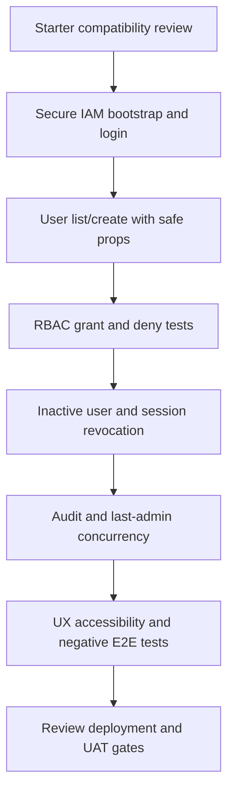

# DOC-018 | P0.8 Laravel + Vue Source Organization Workshop

> v0.1 DRAFT · 29 October 2026 · **NO FILE STRUCTURE FROZEN OR CREATED**  
> Stack families: Laravel + Vue + MySQL (selected); Inertia 3 and TypeScript are preferred technical integration.  
> Scope: System Core MOD-001 first, supporting MOD-003 security, minimal MOD-002 later. **HR Core MOD-004..011 HOLD**.  
> This is a design-choice **workshop proposal** and **not a directory creation instruction** for Codex.

## 1. Recommended starting principle

Use the **official Laravel 13 Vue starter kit conventions**, organize System Core source code by **responsibility and feature** without moving the whole application into a custom Domain-Driven Design framework on day one.

Why this fits the project: a single Laravel-experienced developer is learning Vue 3. The starter already has established routing, authentication/session handling, Inertia page rendering, TypeScript, build pipeline and UI conventions. Preserving those defaults reduces upgrade and onboarding friction. Laravel policy classes remain the server authorization boundary.

**Avoid:** two repositories with duplicated auth, a generic service/repository interface per model, manual dependency container abstractions everywhere, hard-coded user role checks throughout Vue, and invented employee/domain modules without requirements.

## 2. Alternative patterns

| Alternative | Description | Benefits | Risks | Recommendation |
|---|---|---|---|---|
| A. Laravel-conventional with feature grouping | Keep starter's `app/`, `resources/js/`, `routes/`, `tests/` layout. Group User Management page/components and backend policies/actions by responsibility. | Familiar Laravel model, low cognitive load, easy upgrades, fast first feature | Needs discipline to prevent controllers from becoming too large | **PREFERRED FOR REVIEW** |
| B. Domain module packages in a monolith | Create `Modules/Identity`, `Modules/Settings`, `Modules/HR` boundaries and custom providers/autoload. | Strong explicit future feature boundaries | More bootstrap, migration discovery, IDE/agent overhead and integration complexity before concrete HR requirements | DEFER until demonstrated need |
| C. Separate Laravel API + Vue SPA | Different repos/deployments, Vue Router, separate REST/auth contracts | Independent front/back releases and future public API | Extra JWT/CORS/CSRF/session concerns, additional build and deploy, larger learning curve | NOT RECOMMENDED for initial browser UI |

**Chosen direction for discussion:** A. **Final directory names and placement are not yet accepted.**

## 3. Example source organization (ILLUSTRATIVE ONLY)

```text
<project root>/
  app/
    Http/
      Controllers/                  # Inertia page and command endpoints
      Requests/                     # Laravel validation and authorization input boundaries
    Models/                         # User, Role, Permission, AuditEvent (if approved)
    Policies/                       # Per-action and per-target authorization
    Actions/                         # Candidate account lifecycle operations
    Support/                         # Candidate shared auth/audit abstractions
  resources/
    js/
      pages/                         # Inertia pages for Login, User List, User Detail, My Profile
      components/                    # Reusable UI, form fields and System Core widgets
      composables/                   # Vue Composition API helpers only when genuinely reused
      types/                         # Typed safe Inertia account/page props
      layouts/                       # Starter-compatible layouts
  routes/
    web.php                          # Same-origin, session-authenticated browser routes
  database/
    migrations/                      # Laravel/MySQL changes only after schema sign-off
    seeders/                         # Safe permission catalogue; NEVER default admin credentials
  tests/
    Feature/                         # Laravel auth/RBAC, negative and lifecycle scenarios
    Unit/                            # Focused pure policy/validation tests
    ...                               # Actual Vue/browser suite location to be decided
```

**WARNING:** The example names above are not a file creation plan. Adopt exact casing/names only after inspecting the installed starter kit. Do not rewrite the starter to fit an arbitrary example. No `Modules/HR` implementation should exist before HR Core requirements.

## 4. Clear ownership boundaries

| Concern | Authoritative layer | Frontend responsibility |
|---|---|---|
| URL/page navigation | Laravel route + Inertia | Navigate with Inertia links; no duplicate client router by default |
| Login/session | Laravel auth and session middleware | Display login form, safe errors, loading state |
| User creation/update | Laravel validated request and account action | Collect allowed fields; show validation errors |
| RBAC authorization | Laravel policies/permission checks + account state | Receive minimal display hints; do not gate security client-only |
| User list/pagination | Laravel constrained query + safe projection | Present paginated list, query/filter controls |
| Account audit | Laravel restricted event writer | Show authorized audit subset only if approved |
| UI state | Vue `ref`/`computed`, component props, Inertia forms | Keep state local until actual cross-page state requirement |
| Database transactions | Laravel/MySQL | No client-side write-lock orchestration |
| HR rules | **None until HR requirements** | No speculative HR screens or tables |

## 5. Vue-specific education and maintainability

1. First learn Single File Components: `<template>`, `<script setup lang="ts">`, `ref`, `computed`, props and emit.
2. Use **small page components** for list/details/create/edit; extract shared controls only after repeated use.
3. Keep form state in Inertia/Vue; error responses must come from server validation. Preserve focus and loading states.
4. Use TypeScript for safe page-prop contracts; **never** send password hashes, internal auth/session secrets or full Eloquent User serialization to Vue.
5. Avoid Pinia or broad global state for initial System Core. Shared role/action flags must not substitute server policy enforcement.
6. Avoid Vue Router, separate API/axios CRUD, SSR and microfrontends until a concrete requirement warrants them.
7. Accessiblity: keyboard reachable, sensible tab order, visible focus, 360px responsive, restrained transitions and reduced-motion support.
8. Functional tests should cover unauthorized direct requests in Laravel, component behaviors in Vue and end-to-end account flows against MySQL as appropriate.

See [DOC-012 Vue Onboarding](../learning/DOC-012_Vue_Onboarding_MOD-001_v0.1_DRAFT.md).

## 6. Design contracts before any file tree is accepted

| Contract | Review decision |
|---|---|
| Feature ownership | Is MOD-001 one Laravel application feature group with user, role and auth flows? **Proposed yes** |
| Code boundaries | Do we need separate Actions/Services? Add only where transaction/audit complexity warrants |
| RBAC implementation | Laravel Policies/Gates and small tables, or one supported reviewed package; not both |
| Identity/provider | Verify actual starter auth flows and decide secure bootstrap, reset and privileged MFA |
| Vue components | Which starter UI primitives should remain and which should be replaced? Defer to POC review |
| Naming | Agree style for controller, request, policy, page, form and test naming after starter inspection |
| Shared layout | A generic System Core dashboard shell only; HR navigation remains unimplemented |
| Testing | Confirm PHP test runner, Vue unit tests, browser E2E runner and MySQL integration fixture |
| Deployment | Review local Docker vs target server, image-based deployment, secrets, backups and release constraints separately |
| API and external integrations | No separate API until approved use cases; avoid premature CORS/JWT |
| Ownership | One developer maintains both layers; need bounded feature slices and documentation links |

## 7. Candidate implementation slices (not authorized)



**Prerequisite:** resolve critical account, admin, recovery/credential and security policy decisions; approve schema and physical structure in a separate decision record; update SRS/RTM/Excel+CSV only if normative requirement behavior changes.

## 8. Workshop disposition

| Decision | This draft | Required approval |
|---|---|---|
| Use starter conventions rather than DDD-by-default | **Recommended** | Developer/IT technical review |
| Physical folders/naming | **Not frozen** | Joint file structure workshop |
| Frontend route strategy | Inertia same-origin **recommended** | ADR-006 acceptance |
| RBAC code layout/package | **Open** | Permissions/security review |
| App/MySQL schema | **Open** | DOC-017 physical schema review |
| Docker/services layout | **Deferred** | Infrastructure workshop |
| HR module implementation | **HOLD** | HR requirement and authorization |

**No source folders, files, migrations or Vue components have been created in this phase.**

## Official documentation

- https://laravel.com/docs/13.x/starter-kits
- https://laravel.com/docs/13.x/frontend
- https://laravel.com/docs/13.x/authorization
- https://vuejs.org/guide/introduction
