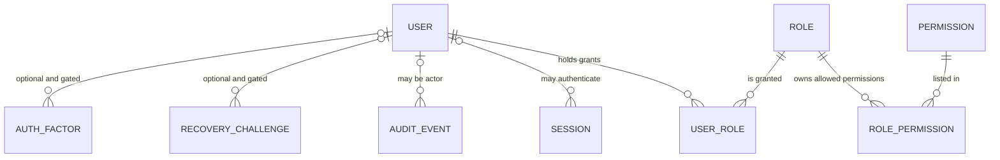

# DOC-015 | MOD-001 System Core Logical Data Model

> **Version:** v0.1 DRAFT • **Recorded:** 29 October 2026
>
> **Status:** ARCHITECTURE REVIEW ONLY. No SQL, migration, Laravel model, table name, type, index, relation FK, Docker/hosting layout, or physical file structure is approved.
>
> **Coverage:** MOD-001 User Management and necessary MOD-003 security/audit. MOD-002 configuration only if explicitly needed. **MOD-004..MOD-011 HR Core ON HOLD pending HR requirements.**
>
> **Depends on:** [SCOPE-001](../decisions/SCOPE-001_system-core-vs-hr-core.md), [DOC-005 IAM SRS](../srs/DOC-005_Identity_Access_SRS.md), [DOC-008 architecture](../architecture/DOC-008_System_Core_Solution_Architecture_v0.1_DRAFT.md), [DOC-013 technical defaults](../decisions/DOC-013_MOD-001_IAM_Technical_Decisions_v0.1_DRAFT.md) and [DOC-014 contracts](../design/DOC-014_MOD-001_Authentication_Authorization_Contracts_v0.1_DRAFT.md). [DOC-011 Functional Design](https://github.com/harishaikal940322/kutmb-hr/pull/1) remains an independent open draft PR.

## 1. Design objectives and non-goals

Model the **identity of an application user**, the **privileges they may exercise**, the **sessions through which they act**, and the **evidence for privileged changes**. Ensure security policy is enforced by Laravel, never inferred from Vue component visibility.

**Non-goals:** Employee/People/Organization master, employee number, departments, positions, payslips, leave, payroll, HR workflows, generic settings data, speculative multi-organization tenancy, full SSO, public APIs, and implementation directory structures.

**Core invariant:** `User ≠ Employee`. An account must be creatable without an employee record, an `employee_id` reference or any HR Core schema.

## 2. Conceptual entity relationship model

**Interpretation:**

- `USER_ROLE` and `ROLE_PERMISSION` represent logical many-to-many grants; **not** an authorization implementation specification.
- `SESSION` represents session state conceptually. A Laravel session store might contain anonymous sessions; the association to an authenticated user is therefore optional. Implementation may use the framework's existing sessions persistence instead of a separate application table.
- `AUDIT_EVENT.actor` may be null/system for successful bootstrap, denied anonymous attempts or background system actions. Audit targets may outlive or differ from the actor, and need safe identifiers.
- `RECOVERY_CHALLENGE` and `AUTH_FACTOR` are **conditional entities only**. They must not be activated or physically created before the reset/SSO/MFA decision and security review.
- The diagram deliberately contains **no EMPLOYEE, ORGANIZATION, HR_ROLE or HR transaction entity**.

## 3. Logical entity catalogue

| Entity | Responsibility | Logical identity | Relationship | Governance |
|---|---|---|---|---|
| `User` | Stable account principal and eligibility state | Opaque, non-recycled `user_id` | 0..n role grants; 0..n authenticated sessions | **Required logical concept**, field/identifier details open |
| `Role` | Named, controlled collection of operational permissions | Stable `role_id`; immutable internal `role_code` proposal | 0..n users via UserRole, 0..n permissions via RolePermission | **Required logical concept**, catalogue and ownership open |
| `Permission` | Fine-grained operation identifier, not a UI menu label | Stable `permission_id` and internal code | RolePermission | **Required logical concept**, codes/policy review pending |
| `UserRole` | An explicit role grant/revoke relationship | User + Role association; unique active grant | User, Role; actor/recorded time as audit evidence | **Required logical concept** |
| `RolePermission` | Definition of allowed actions for a role | Role + Permission association | Role, Permission | **Required logical concept** |
| `Session` | Active browser session and invalidation/revocation support | Framework/session-specific opaque identifier, never exposed via props | May relate to User | **Required behavior**; actual driver/physical entity TBD |
| `AuditEvent` | Evidence of privileged mutations, denied attempts and security changes | Stable `event_id` or generated event identifier | Optional actor, target reference, request context | **Required concept**; retention/tamper-evidence/access pending |
| `Credential` | Secure authentication verifier for local password auth | Internal reference bound to User, if needed | User | **Conditional**; no recoverable passwords, physical model TBD |
| `RecoveryChallenge` | Time-limited identity-verification/reset attempt | One-time nonce/token verifier, if approved | User | **GATED** by UM-DEC-005; never log raw tokens |
| `AuthFactor` | Enrollment and recovery state for approved MFA | Internal factor identity, if approved | User | **GATED** by UM-DEC-011; factor storage and reset policy TBD |

**Simplification rule:** The team need not create a separate `Credential` record, grant model, or auth-factor table merely because this conceptual model mentions them. Leverage reviewed first-party framework behavior and add entities only when an accepted requirement demands them.

## 4. Minimum logical attribute dictionary

| Entity | Attribute | Business meaning / constraint | Classification | Status |
|---|---|---|---|---|
| User | `user_id` | Stable opaque principal; not based on employee ID, IC/passport or email | Internal identifier | DESIGN DEFAULT |
| User | `username` | Unique login handle within an agreed uniqueness scope | Account identifier | DESIGN DEFAULT / uniqueness scope OPEN |
| User | `canonical_username` | Normalized comparison key, potentially derived rather than stored separately | Account identifier | DESIGN DEFAULT / normalization rules OPEN |
| User | `display_name` | Minimal user-facing name | Personal data | DESIGN DEFAULT |
| User | `email` | Optional contact address only if approved; not inherently verified | Personal/contact data | CONDITIONAL |
| User | `status` | `ACTIVE` or `INACTIVE`; `PENDING_SETUP` only if onboarding needs it | Access-control state | DESIGN DEFAULT |
| User | `created_at`, `updated_at` | Trace change time; storage/presentation zone documented at architecture review | Operational metadata | DESIGN DEFAULT |
| User | `last_login_at` | Optional activity marker; not source of truth for active session | Security/activity metadata | OPTIONAL |
| Role | `role_code`, `role_label` | Internal stable permission bundle and display label | Security policy data | PROPOSED |
| Permission | `permission_code` | Identifies operation (e.g. `users.create`), not a route or UI toggle | Security policy data | PROPOSED |
| UserRole | `user_id`, `role_id` | Effective association between principal and role | Security grant | DESIGN DEFAULT |
| RolePermission | `role_id`, `permission_id` | Role-to-operation grant | Security grant | DESIGN DEFAULT |
| Session | `session_handle` | Random bearer identifier protected by cookie/server; not application-user data | **SECRET** | REQUIRED BEHAVIOR / storage TBD |
| Session | `user_id`, `expires_at` | Optional authenticated association and session expiration | Sensitive security metadata | REVIEW REQUIRED |
| AuditEvent | `event_id`, `action`, `result` | Which action occurred and whether allowed/succeeded/failed | Sensitive security metadata | DESIGN DEFAULT |
| AuditEvent | `actor_id`, `target_type`, `target_id` | Who acted and on which account/role/permission | Sensitive security metadata | DESIGN DEFAULT |
| AuditEvent | `occurred_at`, `request_correlation_id` | Event time and bounded correlation to request | Sensitive security metadata | DESIGN DEFAULT |
| AuditEvent | `safe_metadata` | Minimal redacted context, never secrets/full user objects | Sensitive security metadata | REVIEW REQUIRED |
| Credential | `password_verifier` | Adaptive one-way password hash if local auth chosen | **SECRET/RESTRICTED** | CONDITIONAL |
| RecoveryChallenge | `challenge_verifier`, `expires_at`, `consumed_at` | Proof of one-time approved recovery, not raw token | **SECRET/RESTRICTED** | **GATED** |
| AuthFactor | `factor_type`, `factor_status` | Optional reviewed MFA enrollment state | **SECRET/RESTRICTED** | **GATED** |

**Do not model or transmit in current System Core:** employee/staff ID required link, date of birth, national ID, salary, medical data, employment status, departments, employment grades, or other HR personal attributes. No secrets in Vue Inertia props, audit records or Git.

## 5. Data integrity and domain invariants

| Invariant ID | Invariant | Why | Existing requirement / test |
|---|---|---|---|
| DI-001 | Every User has an immutable stable internal identity, independent of username changes and HR employee records | Prevent broken references | SYS-DR-001 / T-SYS-DR-001 |
| DI-002 | Normalized login handle must be unique **at the MySQL persistence boundary**, not only in Vue/Laravel preflight | Concurrent duplicate protection | IAM-FR-002 / T-IAM-FR-002 |
| DI-003 | Unapproved user, disabled user or revoked identity cannot access any protected operation via preexisting browser session | Server authorization | IAM-FR-009 / T-IAM-FR-009 |
| DI-004 | Users cannot self-assign roles or privilege/status fields through forged Vue form payloads | Privilege escalation | IAM-FR-008 / T-IAM-FR-008 |
| DI-005 | Role grants and role permission mapping cannot silently exceed actor's grant scope; deny by default | Horizontal/vertical access control | IAM-FR-006/007 / T-IAM-FR-006/007 |
| DI-006 | At least one **active, eligible authorized System Admin** must remain after privileged mutations; concurrency safe | Prevent platform lockout | IAM-FR-010 / T-IAM-FR-010 |
| DI-007 | A privileged change must have safe, attributable audit evidence or the operation must follow an explicitly reviewed reliable failure policy | Detect unauthorized admin actions | IAM-AUD-001 / T-IAM-AUD-001 |
| DI-008 | Routine deactivation cannot delete historical audit/privilege evidence or automatically hard-delete the User | Investigations and history | IAM-FR-005 / T-IAM-FR-005 |
| DI-009 | A session is not an eternal authorization grant; each protected request re-checks account status and current effective permissions | Revocation without stale privilege | SYS-SEC-001 / T-SYS-SEC-001 |
| DI-010 | No Employee entity/foreign key is required to create a System Core account | Scope protection | SYS-DR-001 / T-SYS-DR-001 |
| DI-011 | Password verifier, bearer cookie and reset/MFA secrets must never be included in ordinary Inertia props, support exports or audit metadata | Prevent credential disclosure | SYS-SEC-002 / T-SYS-SEC-002 |
| DI-012 | User/Role/Permission identifiers must not be silently reused after revocation/deprecation | Historical referential integrity | SYS-AUD-001 / T-SYS-AUD-001 |

**Status:** Invariants are engineering design proposals linked to existing DRAFT requirements. They do not constitute 12 new business requirements or approved test results.

## 6. Proposed lifecycle and state semantics

- **User:** ACTIVE ↔ INACTIVE under authorized action and last-admin constraint. PENDING_SETUP requires an approved first-login/onboarding process; not part of the v0.1 minimum state machine.
- **Role grant:** absent ↔ granted; grant/revoke always checks actor privilege and target; changes are attributable and effective for subsequent protected operations.
- **Session:** unauthenticated → authenticated → invalidated/expired; disabling user or changing effective permissions must deny unauthorized next requests.
- **Audit event:** created with explicit outcome and minimal safe metadata → retained under access/retention policy. Physical immutability/tamper-evidence approach is not selected; merely storing rows is not automatically tamper-proof.
- **Credential recovery:** currently **unavailable/gated** until secure delivery, expiration, one-time use and identity verification are agreed.
- **MFA:** privileged production login not approved until enrollment/recovery and lockout policy are reviewed.

## 7. MySQL and Laravel boundary (not physical design)

1. **Uniqueness:** define and test username normalization (e.g. case-insensitive ASCII canonical handle if adopted), and compare using a deliberate MySQL collation/unique index strategy. Application trim/check alone is insufficient.
2. **Concurrency:** the last-admin safety invariant needs a serialized consistency boundary using a reviewed InnoDB transaction/locking strategy. **Do not** rely on a `COUNT(*)` check outside a transaction or treat the database default isolation as proof of safety. Review deadlock retry and rollback behavior.
3. **Grant changes:** update role state and security audit consistently; design how revocation invalidates authorization on the next request across multiple app workers.
4. **Session:** Laravel supports a database session driver; this may reduce operational components, but session storage alone cannot enforce revoked permissions without status/authorization checks.
5. **Audit:** actor and target references must remain meaningful even if accounts are deactivated. Review soft-deletion implications, safe event metadata, access restriction, export and retention/disposal.
6. **Time:** prefer a clearly defined canonical time basis and a separate display timezone policy; precise DB types and precision remain physical-design choices.
7. **Performance:** design bounded pagination and role lookup; choose indexes after data and authorization query patterns are reviewed.
8. **Operational:** migrations, backup schedule, PITR/RPO/RTO, at-rest encryption, key rotation, connection privilege and retention policy await infrastructure and compliance decisions.

MySQL InnoDB locking and transaction details depend on access path/isolation, so physical locking and index choices must be tested against the chosen MySQL target, including concurrent admin changes.

## 8. Open decisions before physical ERD

| ID | Question | Suggested option | Authority/status |
|---|---|---|---|
| DATA-DEC-001 | One organization only or future tenant scoping for username/roles? | **Single System Core instance by default**, no `organization_id` until approved | Q-001 / OPEN |
| DATA-DEC-002 | Opaque ID type: ULID/UUID/bigint? | Decide after Laravel/MySQL storage/index review | TECHNICAL / DEFERRED |
| DATA-DEC-003 | Username allowed characters, case folding, reserved handles, max length and rename policy? | Limited ASCII, canonical value, case-insensitive uniqueness, **no policy approved** | UM-DEC-001 / OPEN |
| DATA-DEC-004 | Are emails unique, verified or optional and how is account recovery delivered? | Optional, not a login principal for initial design | UM-DEC-002/005 / OPEN |
| DATA-DEC-005 | Can users have multiple roles and can delegated admins manage role bundles? | Model supports many-to-many, but seed only reviewed grants | UM-DEC-004 / OPEN |
| DATA-DEC-006 | Is `PENDING_SETUP` necessary and how are first credentials enrolled? | Only if approved onboarding requires it | UM-DEC-005 / OPEN |
| DATA-DEC-007 | Which session driver, idle timeout, all-device revocation and privilege-change invalidation? | Database-backed candidate with backend state checks | UM-DEC-006 / OPEN |
| DATA-DEC-008 | Audit retention, actor privacy, export rights, append-only/tamper-evidence mechanism? | Require security/compliance approval, no fixed number | UM-DEC-012 / OPEN |
| DATA-DEC-009 | Atomic last-admin guard and error handling for simultaneous writes? | Review InnoDB locking and retries in implementation blueprint | UM-DEC-003/004 / OPEN |
| DATA-DEC-010 | Auth factors and recovery challenge physical requirements? | Defer until secure, reviewed authentication policy | UM-DEC-005/011 / GATED |
| DATA-DEC-011 | How is role grant revocation propagated across session workers? | Backend live policy checks; implementation design TBD | UM-DEC-006 / OPEN |
| DATA-DEC-012 | Physical indexes/unique keys/collations, migrations and source folders? | Discuss **later with owner**, no freeze here | DOC-008 / DEFERRED |

**Do not mark these decisions closed on the strength of this document alone.**

## 9. Verification mapping and handoff

See [Data Integrity Test Matrix](../quality/MOD-001_Data_Integrity_Test_Matrix_v0.1_DRAFT.md). It proposes concurrency and negative test scenarios mapped to existing requirement/test IDs. These are *subcases*, not new SRS/RTM requirements. The normative 32-item RTM, v0.3 Excel and module CSV are unchanged.

### Design exit checklist

- [ ] Confirm key identity/uniqueness and minimum-field policies
- [ ] Confirm admin bootstrap and permission catalogue/hierarchy
- [ ] Confirm session revocation, timeouts and recovery method
- [ ] Approve audit/privacy retention and actor/target visibility
- [ ] Choose physical ID, MySQL collation/constraints, session driver, locking mechanism in a **separate workshop**
- [ ] Choose physical ERD, Laravel/Vue file structure and deployment design **with the owner**
- [ ] Update SRS/RTM/Excel+CSV via CR when normative behavior changes; never silently replace IDs
- [ ] Execute MySQL integration/concurrency tests with evidence before claiming security or release readiness

**Current conclusion: Logical model ready for discussion, NOT ACCEPTED, NOT DEV READY.**
