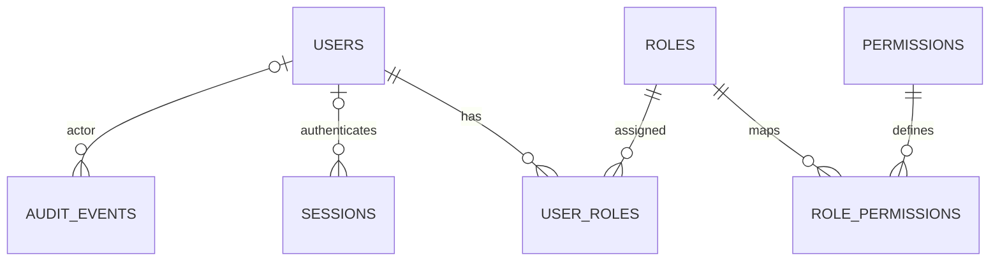
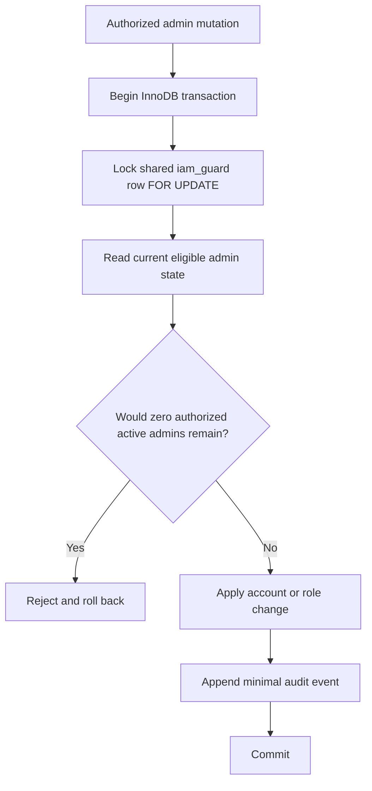

# DOC-017 | P0.8 MOD-001 Physical Schema Proposal

> v0.1 DRAFT · 29 October 2026 · **DESIGN REVIEW ONLY**  
> **No SQL/migrations executed. No schema, file layout or deployment freeze.**  
> Scope: MOD-001 and essential MOD-003; HR Core MOD-004..011 HOLD.  
> Input: [DOC-015 logical model](DOC-015_MOD-001_Logical_Data_Model_v0.1_DRAFT.md), [DOC-013 technical defaults](../decisions/DOC-013_MOD-001_IAM_Technical_Decisions_v0.1_DRAFT.md), [DOC-016 readiness](../reviews/DOC-016_P0.7_System_Core_Technical_Readiness_v0.1_DRAFT.md), [DOC-005 SRS](../srs/DOC-005_Identity_Access_SRS.md).

## 1. Design direction

Prefer Laravel's first-party User and Session facilities and MySQL 8.4 LTS as a **candidate**, rather than a separately deployed identity service. Internal `BIGINT UNSIGNED` IDs are simplest for starter compatibility and joins; add a separate opaque public identifier only if future product needs justify it. **Unpredictable IDs never replace authorization**.

The following are **candidate table/column names**, not approved DDL. Compare the installed Laravel 13 Vue starter kit's actual migrations before deciding which built-in structures to retain or change.

**Important:** `iam_guard` (below) is a standalone singleton **transaction lock primitive**, *not* an FK parent of users. Credential recovery/MFA are conditional entities and not included in the required schema.

## 2. Proposed table inventory

| Table candidate | Minimal purpose / fields | Database rules | Status |
|---|---|---|---|
| `users` | `id`, `username`, `username_canonical`, `display_name`, nullable `email`, `status`, conditional `password`, timestamps | PK id, UNIQUE username_canonical; no employee FK | Proposed |
| `roles` | `id`, stable `code`, display `name`, optional protected `is_system` | UNIQUE role code; privileged changes audited | Proposed |
| `permissions` | `id`, stable `code`, display `name` | UNIQUE permission code | Proposed |
| `user_roles` | `user_id`, `role_id` | Composite UNIQUE, FK restrictions; separate audit events | Proposed |
| `role_permissions` | `role_id`, `permission_id` | Composite UNIQUE, FK restrictions; controlled edits | Proposed |
| `sessions` | Laravel framework-native database session payload and user association | Keep starter/driver-compatible format; secrets never sent to Vue | Preferred |
| `audit_events` | `id`, `occurred_at`, nullable actor, action, target key, outcome, minimal redacted metadata | Indexed by validated read patterns; restricted access and retention | Proposed |
| `iam_guard` | `id=1` singleton, optional revision | One shared transaction lock to serialize eligibility-changing writes | Proposed, requires proof |
| Recovery tokens / factor tables | Verified recovery challenges or MFA enrollment | **Do not enable/create until approved mechanism** | GATED |
| Jobs/cache framework tables | Laravel operational infrastructure | Use defaults only where required | Conditional |

### Field candidates

- `users.id`: `BIGINT UNSIGNED` primary key; never staff ID, IC/passport or HR record ID.
- `users.username`: `VARCHAR(64)` display handle. `username_canonical`: `VARCHAR(64)` unique comparison value; normalization, collation and reserved-name rules remain **OPEN**. Concurrency proof must rely on the DB constraint.
- `users.display_name`: `VARCHAR(160)`; `email`: nullable `VARCHAR(254)`, not automatically a login ID or verified reset channel.
- `users.status`: `VARCHAR(24)` with reviewed allowed values (`ACTIVE`, `INACTIVE`; `PENDING_SETUP` only if approved provisioning needs it). A MySQL CHECK constraint is an option, not yet chosen.
- `users.password`: compatible adaptive one-way hash field if local password auth is approved; **NULL only in an explicitly designed non-login pending-enrollment state**. No default/shared plaintext password.
- `users.created_at`, `updated_at`: temporal columns with consistent storage timezone policy; precision and datatype to review.
- `roles.code`: candidate `VARCHAR(80)` unique; `permissions.code`: candidate `VARCHAR(100)` unique.
- `user_roles` and `role_permissions`: BIGINT FKs and composite unique keys. Prefer restricted deletion over cascade loss of privilege history.
- `audit_events`: candidate BIGINT ID, DATETIME timestamp, nullable actor user ID, action `VARCHAR(120)`, target type/key, outcome, optional correlation ID and **allowlisted** JSON metadata. Audit actor may be absent for bootstrap or unauthenticated denial. Audit targets must remain meaningful after account deactivation.
- `sessions`: don't invent schema before inspecting Laravel's actual database session migration. Session payload/ID is restricted data.
- `iam_guard`: a seeded singleton row for lock serialization, not a generic system setting exposed to Vue.

Do **not** create `employees`, `employee_id`, HR department/position/payroll or tenant/organization relationships based on speculation.

## 3. Atomic invariants and MySQL transaction plan

### Username uniqueness

1. Review allowed charset, case-folding, trim, reserved names, uniqueness scope and rename policy.
2. Normalize the submitted username in the Laravel validation/application boundary.
3. Use a **UNIQUE MySQL key** whose comparison semantics match the normalization policy.
4. Under concurrent requests only one canonical duplicate can commit; return sanitized duplicate feedback, not SQL details.

### Last eligible System Admin

Every account deactivation, active System Admin grant/revoke, admin-role mutation, role permission edit or other operation that can change **eligible active admin count** must use the **same lock domain**. A count performed outside transaction, or a locking read on only one target admin, is insufficient for two concurrent write requests. Implementation must address lock order, deadlock retry, failure and authorized emergency recovery. Restricted DB privileges and code review should reduce bypass paths. Verify on **real MySQL/InnoDB**, not only SQLite/mocks.

### Role grants and session state

Role grant/revoke must be per-actor/per-target authorized and audited; existing sessions must **not** retain privilege after a committed revoke. Every protected operation re-evaluates current account state and relevant permission. Database session persistence by itself does not imply immediate revocation.

### Audit integrity

Preferred first implementation: privileged mutation and redacted audit append within the **same MySQL transaction**. If later an external audit sink is needed, review a reliable outbox mechanism rather than trusting best-effort logging. Denied requests need separately rate-limited security telemetry. Audit retention/reader permissions are organizational decisions.

## 4. Eloquent and RBAC implementation options

| Concern | Option A (preferred initially) | Option B | Decision needed |
|---|---|---|---|
| User | Extend standard Laravel User and authentication | Bespoke identity provider | Prefer A unless hard requirement |
| RBAC | Laravel Policies/Gates + small role/permission tables | Reviewed maintained package | Package version/license/security/ownership |
| UserRole/RolePermission | Controlled relationship mutation service with authorization | Package-managed pivots | Avoid two conflicting privilege sources |
| Session | Native Laravel session infrastructure | Custom session service | Prefer native if required revocation proven |
| AuditEvent | Restricted model and append service | External audit sink/outbox | Access, retention, failure contract |
| IamGuard | Singleton transaction serialization | Equivalent formally proven concurrency control | Select after integration tests |
| Recovery/MFA | Reviewed Laravel starter/Fortify paths, feature gated | Custom cryptography | **Do not build custom crypto** |

Do not install a role package, migrate tables or create source files in this planning PR.

## 5. Physical schema approval checklist

- [ ] Confirm single vs multi-organization scope and username normalization/rename rules.
- [ ] Review actual Laravel starter user/session/reset tables and decide reuse rather than duplication.
- [ ] Confirm first-admin bootstrap, RBAC grants and privileged MFA/recovery policy.
- [ ] Select MySQL version, collation, index strategy and database role privileges.
- [ ] Prove atomic last-admin protocol including two simultaneous removals on InnoDB.
- [ ] Decide audit/privacy retention and reliable event write contract.
- [ ] Design migration order and rollback **after owner approval**, not in this document.
- [ ] Keep system independent of HR Core requirements and data.

**Approval:** NOT APPROVED. **Migration count:** 0. **Tests executed:** 0.

## Sources

- Laravel 13 starter kits: https://laravel.com/docs/13.x/starter-kits
- Laravel 13 migrations: https://laravel.com/docs/13.x/migrations
- Laravel 13 session: https://laravel.com/docs/13.x/session
- MySQL 8.4 locking reads: https://dev.mysql.com/doc/refman/8.4/en/innodb-locking-reads.html
- MySQL 8.4 isolation: https://dev.mysql.com/doc/refman/8.4/en/innodb-transaction-isolation-levels.html
