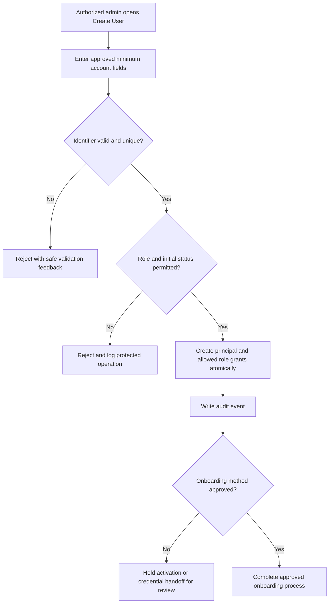
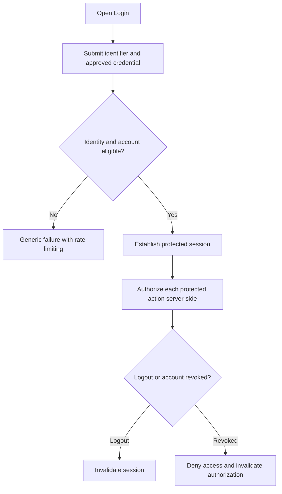
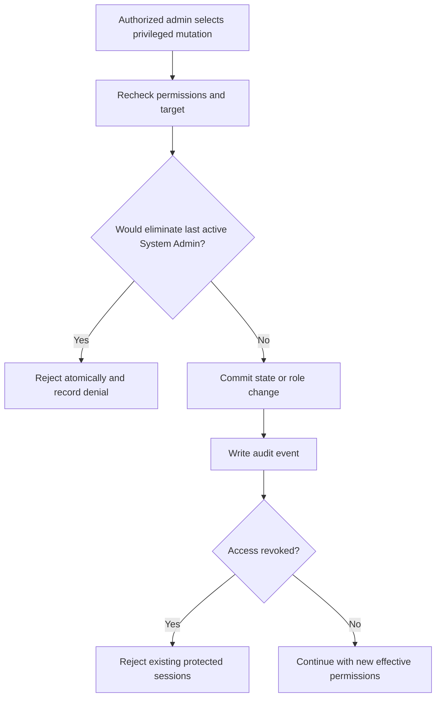
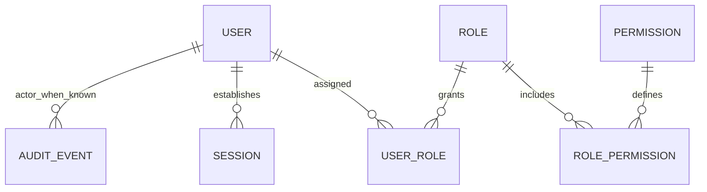

# DOC-011 | MOD-001 User Management Functional Design

> **Version:** v0.1 DRAFT • **Date:** 29 October 2026 • **Approval:** NOT APPROVED
>
> **Area:** System Core, MOD-001 User Management & Identity Access.
> **Purpose:** Reviewable *functional design proposal* derived from [DOC-005](../srs/DOC-005_Identity_Access_SRS.md), [DOC-004](../srs/DOC-004_System_Wide_SRS.md), [SCOPE-001](../decisions/SCOPE-001_system-core-vs-hr-core.md) and [MOD-001 decision queue](../requirements/MOD-001_USER_MANAGEMENT_REVIEW_v0.3.md).
>
> **Boundary:** HR Core (MOD-004 onward) is **ON HOLD** pending HR requirements. No functionality, stack, DB schema, permission policy or release is approved by this document.

## 1. Objective, boundaries and actors

Provide a working independent **System Core account management module**: privileged creation and administration of application user accounts; authentication/session control; role/permission enforcement; constrained self-profile; and essential audit trail.

- **System Admin (proposed):** highly privileged initial administrator responsible for access governance.
- **User Admin (proposed):** delegated account operator with explicitly restricted permissions; not automatically permitted to assign privileged roles.
- **Standard User (proposed):** logs in and reads/edits only permitted own-profile fields.
- **HR Admin:** **not automatically created**; HR role and privileges remain future requirements.
- **Security/IT reviewer:** reviews permission boundaries, audit configuration and acceptance results; not implicitly an application role.

**Explicitly excluded:** employee master/employee number requirement, organizational HR structure, salary, leave, attendance, OT, claims, payroll, performance and HR approval processes. An application account **does not require an Employee record**.

## 2. Proposed functional surface (subject to review)

| Screen or operation | Proposed behavior | Requirement | Decision |
|---|---|---|---|
| Login | Active authorized user establishes a session; credential verification and failure handling | IAM-FR-003 | UM-DEC-001/006/011 |
| Logout | Invalidate session and stop protected access | IAM-FR-003 | UM-DEC-006 |
| User list | Search by approved identifier/name, filter by status/role, paginate | IAM-FR-012 | UM-DEC-002/004 |
| Create user | Authorized admin captures approved minimum fields; validates identifier uniqueness; assigns allowed initial role/status | IAM-FR-001/002 | UM-DEC-001/002/003/004 |
| View/edit user | Admin may amend permitted account fields, not silently modify roles/status through generic profile endpoint | IAM-FR-001/005/006 | UM-DEC-002/004 |
| Activate/deactivate | Authorized admin changes access state; deactivation revokes protected access without deleting audit | IAM-FR-005/009 | UM-DEC-006/008 |
| Role assignment | Assign/revoke allowed roles through permission checks and privileged-role restrictions | IAM-FR-006/007/010 | UM-DEC-003/004 |
| My profile | View own profile, edit allowed self-service fields only | IAM-FR-008 | UM-DEC-002 |
| Recover access | Verified recovery channel, one-time/expiring tokens if relevant; **blocked until channel chosen** | IAM-FR-004 | UM-DEC-005 |
| Audit | Record security-relevant administrative actions without credentials/secrets | IAM-AUD-001 / SYS-AUD-001 | UM-DEC-008/012 |

These are *design surfaces*, not a feature approval or scope extension. Some surfaces remain blocked pending decisions.

## 3. Proposed logical user attributes (not a physical database migration)

| Field / concept | Proposal | Required? | Notes / dependency |
|---|---|---|---|
| `id` | Opaque stable internal identifier | Yes | Not derived from employee/staff number |
| `display_name` | User-facing name | Proposed yes | Max length and naming rules TBD, UM-DEC-002 |
| `login_identifier` | Unique principal for authentication | TBD | **Choice unresolved**: username, email, SSO; uniqueness/normalization rules to review |
| `email` | Communication channel if approved | TBD | Do not require or infer delivery without selected reset/invitation channel |
| `status` | Active / Inactive with optional Pending Setup | Yes (conceptual) | Pending state only if credential onboarding needs it |
| `auth_method` | Identity mechanism associated with account | TBD | Credential-based vs external SSO not selected |
| `credential_verifier` | Secure server-side verifier (if local password auth) | Conditional | Never log/echo password or token; choice belongs in architecture |
| `roles` | Links to granted roles | Yes conceptually | Roles and grants governed separately from self-profile |
| `created_at`, `updated_at` | Audit timestamps | Yes proposed | Timezone policy open in DOC-004 |
| `created_by`, `updated_by` | Provenance where available | Proposed | System bootstrap actor requires special handling |
| `last_login_at` | Non-authoritative activity metadata | Optional | Retention and access rules TBD |

**Not collected in MOD-001:** IC/passport, DOB, race, medical information, salary, home address, employee ID, department, position, employment status or HR-specific reference fields. Link to an employee entity is **optional future design**, not a current dependency.

**Validation proposal:** trim/normalize accepted identifier before uniqueness check, reject duplicates at persistence boundary even under concurrency, do not reuse IDs, and reject privilege/status edits through self-profile. Exact normalization, length, unique scope and email requirements remain decisions.

## 4. Proposed role-permission matrix

Legend: **A** = proposed allow, **L** = proposed limited or conditional allow, **D** = deny. The below is a *review matrix*, not deployed permissions.

| Permission code | System Admin | User Admin | Standard User |
|---|---|---|---|
| `users.list` | A | A | D |
| `users.create` | A | L (non-privileged users only) | D |
| `users.read` | A | L (approved scope) | D |
| `users.update` | A | L (restricted editable fields) | D |
| `users.deactivate` | A (last-admin protected) | L (non-privileged users only) | D |
| `users.reactivate` | A | L | D |
| `roles.view` | A | A | D |
| `roles.assign` | A (last-admin protected) | L (allowlisted roles only) | D |
| `roles.manage` | A | D | D |
| `audit.view` | L (explicit security approval) | D | D |
| `profile.read.own` | A | A | A |
| `profile.update.own` | A (approved fields only) | A (approved fields only) | A (approved fields only) |

**Mandatory invariants proposed for security review:**
1. Every protected action must be enforced server-side. Hidden buttons are not authorization.
2. No requester may modify their own permissions through self-profile, or assign roles beyond an explicit grant boundary.
3. Last active authorized System Admin cannot be deactivated or stripped of all administrative privileges without a separately approved recovery/transfer mechanism.
4. Revocation/inactivation must prevent further protected operations from existing sessions.
5. A role-permission grant cannot silently escalate through a delegated User Admin. Administrative grants must be audited.

Permission strings and the matrix itself are **provisional until UM-DEC-003/004 and security review**. No blanket HR access is implied by the System Admin name.

## 5. Proposed workflows

### 5.1 Administrator creates an account

**Preconditions:** authenticated actor has `users.create`, and the selected credential/onboarding channel is configured. **Postconditions:** principal ID and role grants created once, audit stored, no credential disclosed in standard UI or logs. **Fail closed:** unknown initial admin procedure or unavailable onboarding channel must not trigger an improvised password/email mechanism.

### 5.2 Login and logout

**Security review points:** HTTPS/session cookie configuration, session rotation on login, brute-force defenses, CSRF for browser mutations, generic auth failure messages, forbidden logging of secrets, timeouts, MFA/SSO decisions. No timeout/MFA policy is claimed approved.

### 5.3 Activate / deactivate / role change

**Concurrency risk:** simultaneous admin changes cannot bypass last-admin protection; enforce invariants at a transaction-safe consistency boundary during implementation. The state history remains available under the approved retention policy.

## 6. Account state model (proposed)

| From | Action | To | Conditions |
|---|---|---|---|
| Not yet created | Authorized create | `PENDING_SETUP` *or* `ACTIVE` | Depends on approved onboarding and credential policy |
| `PENDING_SETUP` | Verified activation | `ACTIVE` | Only if this state is adopted |
| `ACTIVE` | Authorized deactivate | `INACTIVE` | Last-admin protection and session revocation |
| `INACTIVE` | Authorized reactivate | `ACTIVE` or `PENDING_SETUP` | Depends on credential reset policy |
| `ACTIVE` | Change role | `ACTIVE` | Permission grant restrictions and audit |

`LOCKED` for temporary security lockout is a **possible separate security flag**, not an approved account state. No hard delete workflow in the current proposed surface; retention/disposal requirements must be reviewed.

## 7. Logical entities and dependencies

Conceptual entities: User, Role, Permission, UserRole, RolePermission, Session, AuditEvent. **No Employee table, staff FK or HR relationship is needed for this phase.** Relationship cardinality, indexes, physical columns, transaction patterns and framework-specific choices belong to DOC-008 architecture.

## 8. Audit and privacy review

Proposed audit event catalogue:
`user.created`, `user.updated`, `user.deactivated`, `user.reactivated`, `role.assigned`, `role.revoked`, `permission.changed` (if role management enabled), `auth.login_failed` (appropriately rate-limited), `auth.session_revoked`, `admin.last_account_blocked`.

Each event should record the event name, timestamp, actor if known, target identifier, result and minimal safe metadata. **Never record passwords, reset tokens, session secrets or sensitive HR data**. Audit viewer rights and retention duration are not decided; see UM-DEC-012 / Q-010 / Q-011.

## 9. Screen / UX acceptance notes

- **Login:** readable error, keyboard reachability, no disclosure whether a username exists in auth error handling.
- **User list:** clear status/role labels, paginated search and filters; distinguish system roles from HR roles.
- **Create/Edit:** visible required-field cues; preserve user input on safe validation errors; avoid implicit role/status changes.
- **Access state:** confirmation of high-impact actions, rationale/audit as approved; prevent deactivating final admin.
- **My profile:** explicitly limited fields, no direct mass-assignment of privileged properties.
- **Responsive/accessibility:** keyboard-first interactions, meaningful labels, visible focus, reduced motion; 360px and 1280px viewport check from SYS-NFR-001.
- **Performance:** avoid premature specific SLA until user volume and deployment requirements are known.

## 10. Requirement coverage (existing IDs; NO NEW requirement)

| Requirement | Functional design sections | Verification |
|---|---|---|
| IAM-FR-001 | 2, 3, 5.1 | T-IAM-FR-001 |
| IAM-FR-002 | 3, 5.1 | T-IAM-FR-002 |
| IAM-FR-003 | 2, 5.2 | T-IAM-FR-003 |
| IAM-FR-004 | 2, 5.1, 11 | T-IAM-FR-004 |
| IAM-FR-005 | 2, 5.3, 6 | T-IAM-FR-005 |
| IAM-FR-006 | 4, 5.3 | T-IAM-FR-006 |
| IAM-FR-007 | 4, 7 | T-IAM-FR-007 |
| IAM-FR-008 | 2, 3, 9 | T-IAM-FR-008 |
| IAM-FR-009 | 5.2, 5.3, 6 | T-IAM-FR-009 |
| IAM-FR-010 | 4, 5.3 | T-IAM-FR-010 |
| IAM-FR-011 | 1, 9 | T-IAM-FR-011 |
| IAM-FR-012 | 2, 9 | T-IAM-FR-012 |
| IAM-AUD-001 | 8 | T-IAM-AUD-001 |
| SYS-DR-001 | 1, 3, 7 | T-SYS-DR-001 |
| SYS-SEC-001/002 | 4, 5.2, 8 | T-SYS-SEC-001/002 |
| SYS-AUD-001 | 8 | T-SYS-AUD-001 |
| SYS-NFR-001 | 9 | T-SYS-NFR-001 |

For negative/edge-case scenarios see [MOD-001 Functional Test Scenarios](../quality/MOD-001_Functional_Test_Scenarios_v0.1_DRAFT.md). The original [RTM](../requirements/RTM.md) and its 32 IDs are unchanged; no test evidence exists yet.

## 11. Outstanding design decisions, blockers and gates

All 12 `UM-DEC-001..012` remain **OPEN** in [P0.3 review](../requirements/MOD-001_USER_MANAGEMENT_REVIEW_v0.3.md). **Implementation-blocking for initial account/auth work:** UM-DEC-001 login identifier, 002 minimum fields, 003 admin bootstrap, 004 effective role/permission policy, 005 credential distribution/reset, 006 session and revoke policy, 011 security baseline. Audit and privacy approval is required before handling real users.

**Provisional roadmap for review (not execution authorization):**
- FD-01: Approve account fields and login/authentication channel.
- FD-02: Approve admin bootstrap and role-permission matrix.
- FD-03: Approve lifecycle, session revocation and recovery.
- FD-04: Approve security/privacy/audit constraints.
- FD-05: Update DOC-005/RTM/Excel+CSV under change control if normative requirements change.
- FD-06: Prepare DOC-008 architecture and implementation slicing; only then consider DEV READY gates.

**Stop conditions:** No user-module code/deployment in this task, no production credentials/data, no unknown HR rules. Current status is **DESIGN DRAFT, NOT DEV READY**.
