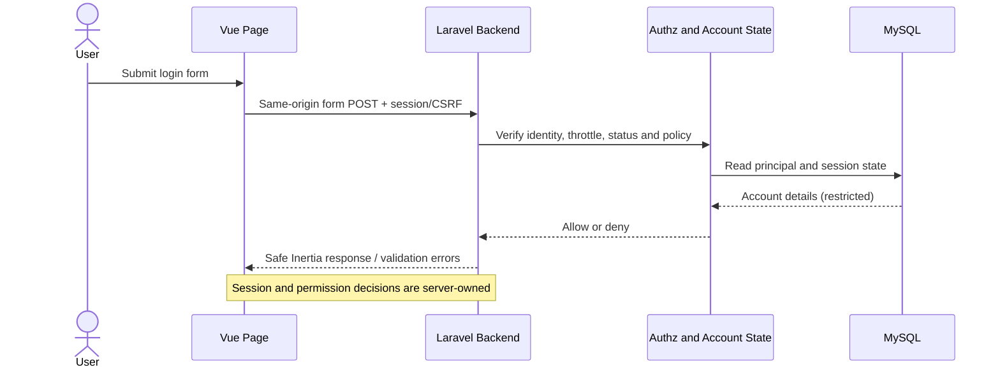

# DOC-014 | MOD-001 Authentication, Authorization & Inertia Contracts

> **v0.1 DRAFT, 29 October 2026** • Technical review artifact only.  
> **No final URL paths, class names, DB schema, file structure, UI component libraries or implementation code are specified.**  
> Reference: [DOC-013 Technical Decisions](../decisions/DOC-013_MOD-001_IAM_Technical_Decisions_v0.1_DRAFT.md), [DOC-008 Architecture](../architecture/DOC-008_System_Core_Solution_Architecture_v0.1_DRAFT.md), [SEC-001 Security](../security/SEC-001_System_Core_Security_Baseline_v0.1_DRAFT.md), [DOC-005 SRS](../srs/DOC-005_Identity_Access_SRS.md).

## 1. Browser ↔ Laravel boundary

Use server-driven Inertia pages. **Vue is presentation and reactive form state, not a trusted role authority.** Request input and role flags are untrusted.

Authentication failure must not reveal whether the username exists. Cookies/session policies are reviewed separately before production. Avoid browser JWT and unrestricted user-model serialization.

## 2. Page contracts (logical, no route names)

| Page/use case | Server supplies (allowlist) | User may submit | Server enforces |
|---|---|---|---|
| Login | Safe generic messaging, CSRF/session context | Username, password under approved auth method | Rate limit, verify, account state, session rotation |
| User list | Paginated IDs, display names, usernames, statuses, permitted role labels; allowed action flags as hints | Search and approved filter parameters | Admin view permission, query constraints, pagination ceiling |
| User detail | Approved account fields and filtered action hints | None, or approved edit input | Per-target read permission |
| Create user | Available **authorized** grantable roles/status values | Minimum account fields and allowlisted initial role | Grant boundary, validation, unique index, safe onboarding |
| Edit account | Editable field allowlist and current safe values | Name/contact fields only | Target authorization, field allowlist, no privilege escalation |
| Role edit | Review-approved grantable role list for actor/target | Explicit role grant/revoke | Protected atomic grants and last-admin safety |
| Account state | Safe account summary and actor permission hints | Activate/deactivate command and approved reason | Last-admin invariant, session revocation, audit |
| My profile | Only actor's allowed self fields | Self-editable fields only | Self ownership; reject status/role/identity tampering |
| Recovery | Only if delivery and identity verification are approved | Verification challenge + new credential | One-use expiry, rate limit, no account enumeration |
| Audit viewer | No general access until separate approved permission and retention | Limited authorized filters | Restrict visibility and redaction |

**Never include:** credential verifier, reset tokens, MFA secret/recovery codes, raw cookies/session IDs, detailed permission graph as global props, future HR employee/health/payroll data or an unbounded full User model.

## 3. Inputs, outputs and response safety

- All field validation and authorization must be performed **server-side**, even when Vue checks locally.
- Vue forms may show safe field-specific errors for creation/editing; login/recovery errors should remain identity-agnostic.
- Mutations use POST/PUT/PATCH/DELETE semantics where suitable under the chosen Inertia adapter; no REST API architecture is required. The exact URL/method mapping is deliberately deferred.
- A failed authorization returns a safe forbidden response without exposing target details; a stale/disabled session is denied at the next protected server operation.
- Never accept `role_ids`, `permissions`, `is_admin`, `status`, `employee_id` or `created_by` from a standard user's own-profile payload, even when hidden form controls are manipulated.
- Use stable, opaque account identifiers and constrain search/filter/ordering to allowlisted columns. Rate-limit sensitive administrative actions as risk-reviewed.
- Always paginate. Do not expose full user tables to Vue when filters/pagination are enough.

## 4. Authorization invariant matrix

| Principal | Own profile | Users list | Create account | Assign roles | Deactivate account | Audit read |
|---|---|---|---|---|---|---|
| Unauthenticated | DENY | DENY | DENY | DENY | DENY | DENY |
| Standard User | SELF FIELDS | DENY | DENY | DENY | DENY | DENY |
| System Admin | OWN ALLOWLIST | ALLOW | ALLOW | ALLOW SUBJECT TO GRANT POLICY | ALLOW EXCEPT LAST ADMIN | REVIEW PERMISSION |
| User Admin (not enabled by default) | OWN ALLOWLIST | REVIEW SCOPE | REVIEW SCOPE | REVIEW ALLOWLIST | REVIEW SCOPE | DENY |
| Inactive account | DENY PROTECTED | DENY | DENY | DENY | DENY | DENY |

**These are conservative design defaults, not approved role policies**. Any new role or permission needs review and negative tests. Do not interpret “System Admin” as blanket permission for HR records.

## 5. State and concurrency invariants

- **Unique principal:** before creation, normalize username according to an approved specification and enforce uniqueness with MySQL database constraint. Concurrent duplicate submits produce a single winning insert and a sanitized duplicate error.
- **Last admin:** concurrent deactivate/revoke operations must not leave zero active authorized System Admins. Enforce atomically with reviewed locks/transactions rather than UI-only checks.
- **Revoked access:** after role removal or deactivation commits, no subsequent protected request may use old privileges. A database session driver alone does **not** prove permission revocation; server authorization must check current state.
- **Audit completeness:** privileged transaction outcomes must have verifiable, redacted evidence. Specify whether audit and mutation share a transaction or reliable outbox during implementation.
- **Reactivation:** never silently restore a compromised session or permanently grant previous privileges without a reviewed policy.
- **Password recovery:** token issuance, delivery, expiry, single-use, revoke, rate-limit and audit rules remain **BLOCKED** until approved recovery method.
- **MFA:** admin production path remains blocked without approved enrollment, backup codes/lockout procedure and secure recovery design.
- **No employee coupling:** all tests must work without an Employee table.

## 6. End-to-end user journeys for first implementation slice

| Slice | Outcome | Existing acceptance/test IDs | Dependency |
|---|---|---|---|
| S1 | Safe bootstrap and first authorized admin login | AC-IAM-FR-001/003/010; T-IAM-FR-001/003/010 | TD-005 security approval |
| S2 | Minimal user list and create | AC-IAM-FR-001/002/012; T-IAM-FR-001/002/012 | TD-001/002/003 |
| S3 | Role grant/revoke and denial | AC-IAM-FR-006/007; T-IAM-FR-006/007 | TD-004/008 |
| S4 | Deactivate/reactivate, session protection, last-admin | AC-IAM-FR-005/009/010; T-IAM-FR-005/009/010 | TD-007/009/011 |
| S5 | Own profile and audit | AC-IAM-FR-008, AC-IAM-AUD-001; T-IAM-FR-008, T-IAM-AUD-001 | TD-002/016 |
| S6 | Approved reset/invitation and admin MFA | AC-IAM-FR-004; T-IAM-FR-004 | **BLOCKED** TD-014/015 |

These six slices are **planning order only**, not work authorization. Final priorities are cross-mapped to the 26 [functional scenarios now consolidated on this branch](../quality/MOD-001_Functional_Test_Scenarios_v0.1_DRAFT.md). They remain DRAFT and unexecuted.

## 7. Definition of ready (technical review, not release)

- [ ] Approved or explicitly accepted minimum user fields, identity canonicalization and unique scope.
- [ ] Approved System Admin bootstrap, role assignment policy, self-profile allowlist.
- [ ] Approved login, revoke and last-admin protection behavior.
- [ ] Documented reset/invite and MFA methods or formally feature-gated pending acceptance.
- [ ] Threat/security review, audit/privacy access and retention decisions.
- [ ] Version compatibility checked with Laravel 13 Vue/Inertia starter and MySQL at implementation time.
- [ ] Joint workshop later establishes physical ERD, folder structure and Docker/deployment plan.
- [ ] Existing SRS, RTM, Excel/CSV aligned if *normative* scope/requirements are changed.

**Current status:** all relevant approval/test gates remain open. This is not a schema or code-generation instruction.
