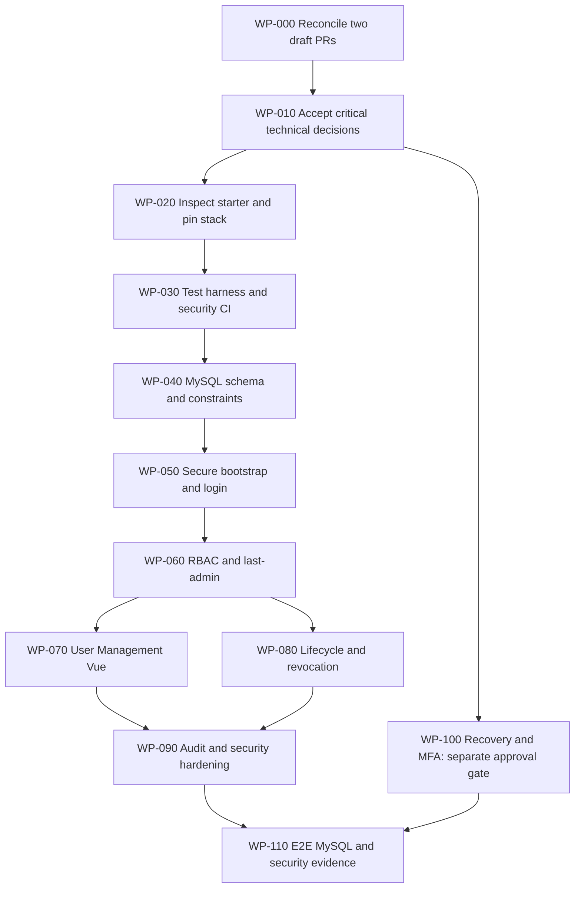

# DOC-020 | P0.9 MOD-001 Implementation Blueprint & Codex Work Packages

> **Version:** v0.1 DRAFT · **Date:** 29 October 2026
>
> **STATE:** IMPLEMENTATION PLAN PREPARED; **NO SOURCE-CODE IMPLEMENTATION AUTHORIZED OR EXECUTED**.
>
> **Scope:** System Core `MOD-001` User Management & Identity Access with concurrent security/audit responsibilities from `MOD-003`; minimum `MOD-002` only if specifically approved. **HR Core `MOD-004..011` remains HOLD** until approved HR requirements.
>
> **User-selected stack families:** Laravel + Vue + MySQL. **Preferred but unapproved technical integration:** Laravel 13, Vue 3/TypeScript, Inertia 3, MySQL 8.4 LTS. Physical schema, starter version, source folders and deployment layout must pass the dedicated review first.
>
> **Normative requirements:** [DOC-005 Identity SRS](../srs/DOC-005_Identity_Access_SRS.md) and [RTM](../requirements/RTM.md) retain all existing DRAFT requirement/AC/test IDs. Planning does **not** imply business/HR sign-off.

## 1. Inputs and authority chain

- [SCOPE-001](../decisions/SCOPE-001_system-core-vs-hr-core.md): System Core first, HR Core blocked.
- [DOC-008 Architecture](../architecture/DOC-008_System_Core_Solution_Architecture_v0.1_DRAFT.md), [SEC-001 Security Baseline](../security/SEC-001_System_Core_Security_Baseline_v0.1_DRAFT.md).
- [DOC-013 IAM Technical Defaults](../decisions/DOC-013_MOD-001_IAM_Technical_Decisions_v0.1_DRAFT.md), [DOC-014 Contracts](../design/DOC-014_MOD-001_Authentication_Authorization_Contracts_v0.1_DRAFT.md).
- [DOC-015 Logical Model](../data/DOC-015_MOD-001_Logical_Data_Model_v0.1_DRAFT.md), [DOC-017 Proposed MySQL Schema](../data/DOC-017_MOD-001_Physical_Schema_Proposal_v0.1_DRAFT.md), [DOC-018 Source Layout Options](../architecture/DOC-018_Laravel_Vue_Source_Organization_Options_v0.1_DRAFT.md), [DOC-019 Decisions](../reviews/DOC-019_P0.8_Physical_Design_Decision_Sheet_v0.1_DRAFT.md).
- Separate [Draft PR #1](https://github.com/harishaikal940322/kutmb-hr/pull/1): DOC-011 Functional Design + **26 proposed functional scenarios**. These documents are **not on this branch** and must not be assumed merged.
- This branch's [18 proposed data integrity scenarios](../quality/MOD-001_Data_Integrity_Test_Matrix_v0.1_DRAFT.md); see [DOC-021 cross-PR reconciliation](../reviews/DOC-021_MOD-001_PR_Reconciliation_and_Test_Trace_v0.1_DRAFT.md) for overlap.

## 2. Authorization and gate vocabulary

| Stage | Meaning | Allowed right now? |
|---|---|---|
| PLANNING | Documents, mapping, review and proposed work packages | **YES**, within non-sensitive source of truth |
| REVIEWED | Technical decisions backed by owner/reviewer, date, impact and references | **NOT YET** |
| DEV AUTHORIZED | Explicit implementation approval for named work package after mandatory gates | **NO** |
| IMPLEMENTED | Code/migrations committed and peer-reviewed; **tests recorded**, not inferred | **NO** |
| UAT ACCEPTED | Stakeholder sign-off on the specified behavior | **NO** |
| PRODUCTION APPROVED | Release/security/backup gates and accountable approval | **NO** |

**Never** promote a planning status merely because a GitHub PR was opened/merged or an agent reported SUCCESS. A draft work package is *not* a Codex command to run.

## 3. Work-package ledger

IDs `WP-000..WP-110` identify technical tasks, **not new requirement IDs**. Proposed dependencies are deliberately conservative. A work package can be reprioritized only by recording the change and its test/security impact.

| WP | Proposed work | Dependencies / start gate | Definition of done / existing trace | Initial state |
|---|---|---|---|---|
| WP-000 | **Reconcile PR #1 and PR #2**: align Functional Design and Architecture/technical docs; resolve shared README/AGENTS/Register conflicts; recheck all RTM and scenario links | Document review only | DOC-011 and DOC-008 refer to one coherent SRS/RTM; no lost changes; DOC-021 checklist evidenced | PLANNED / DOCS ONLY |
| WP-010 | **Authorize tech design**: confirm username policy, permitted user fields, bootstrap operator, role matrix, recovery feature-gates, session and audit rules | UM-DEC, PD-DEC, DOC-019, IT/reviewer decision | Approved decision register and signed scope; no implied HR approval | BLOCKED / DECISIONS |
| WP-020 | **Inspect official starter and establish toolchain**: review pinned Laravel/Vue/Inertia/MySQL compatibility, npm/Composer provenance, dependency and version constraints | WP-000/010; explicit limited code/POC authorization | Reproducible synthetic-only dev environment; versions/CI constraints documented | BLOCKED / CODE AUTH |
| WP-030 | **Build test harness and CI baseline**: PHP tests, TypeScript build/check, Vue component tests, lint and dependency/secret review | WP-020; test-runner approval | Test commands and CI with no fake PASS, no HR data; scoped negative test list recorded | BLOCKED |
| WP-040 | **MySQL identity/RBAC schema and secure data invariants**: use reviewed physical schema, constraints and migrations only | WP-010/020/030, accepted DOC-017/018, database privileges | MySQL uniqueness/concurrency, safe rollback and synthetic fixtures; `T-IAM-FR-002`, `T-SYS-DR-001` | BLOCKED |
| WP-050 | **First-admin bootstrap and session login/logout**: controlled one-time provisioning, no default password, restricted signup; secure session rotation | WP-040; bootstrap/credential handling accepted; security reviewer | `T-IAM-FR-001/003/010/011`; deny inactive/unknown users, no credential leak | BLOCKED |
| WP-060 | **Authorization + RBAC**: Laravel policies/role grants, never Vue-only checks, last-admin transactional protection | WP-040/050; approved role matrix and MySQL guard protocol | `T-IAM-FR-006/007/008/010`, `T-SYS-SEC-001`; concurrent double-revoke test on MySQL | BLOCKED |
| WP-070 | **Inertia + Vue User Management**: minimal user list, create/edit/own profile, typed props, filters, user-friendly errors | WP-050/060, confirmed field/prop contract | `T-IAM-FR-001/002/008/012`, `T-SYS-NFR-001`; no sensitive props or unauthorized endpoints | BLOCKED |
| WP-080 | **Account lifecycle and live revocation**: deactivate/reactivate, session and role change enforcement on all protected operations | WP-050/060; session policy and state machine accepted | `T-IAM-FR-005/009/010`; old session cannot continue after deactivation | BLOCKED |
| WP-090 | **Audit and security evidence hardening**: redacted actor/target/outcome audit across **all earlier WPs**, consistency of critical mutation + audit, privacy/access review | Audit contract approved **before** WP-050; this WP verifies/hardens rather than postpones audit implementation | `T-IAM-AUD-001`, `T-SYS-AUD-001`, `T-SYS-SEC-002`; no passwords/tokens in logs or props | BLOCKED |
| WP-100 | **Recovery, enrollment, privileged MFA** only after reviewed identity proof, approved channel, privileged emergency recovery | UM-DEC-005/011, security approval; no starter route enabled early | `T-IAM-FR-004`, negative replay/expiry, MFA recovery evidence | **SECURITY BLOCKED** |
| WP-110 | **Integrated security/UAT/release verification**: MySQL real concurrency, browser E2E, accessibility, backup-restore synthetic dry run, operational sign-off | All required earlier WPs; existing GATE-01..08, owner authorization | Reproducible evidence by SHA/environment/test ID, defects closed or explicitly waived by authority | BLOCKED |

**AUDIT IS CROSS-CUTTING:** WP-050/060/070/080 must write required audit events as they are built; WP-090 is a systematic verification/hardening gate, not a promise to bolt security on later. WP-100 may remain gated without silently declaring the complete Identity SRS implemented.

## 4. Proposed implementation and integration order



**Physical file-structure workshop is an explicit condition between WP-010 and WP-040**, not implicitly settled by this graph. The last step only qualifies for review; it does not automatically authorize production.

## 5. First Codex handoff: ONLY AFTER CODING AUTHORIZATION

**Recommended first coding slice:** WP-020 starter-kit compatibility/isolated proof of concept using **synthetic users only**. It must be specifically authorized before execution, and it **does not** create the HR employee module or real admin users. Initial WP-000/010 documentation reconciliation can be handled without code or infrastructure changes.

When a work package is actually authorized, supply a single bounded task:

```text
Project: KUTMB HR System, System Core only (MOD-001; security MOD-003).
Repository: harishaikal940322/kutmb-hr.
Authorized work package: WP-<ID> [provide exact ID, accepted requirements and reviewer sign-off].
Base branch and expected SHA: <exact Git refs>.
Read first: AGENTS.md, SCOPE-001, DOC-005, DOC-008, DOC-013..020,
SEC-001, DOC-019, the accepted decision set, RTM, and any approved DOC-011.
Execute ONLY the named work package, in a clean isolated branch/worktree.
No HR Core entities, requirements, sample personal data or unapproved routes.
Backend authorization and validation are authoritative; Vue never controls access.
No default administrator password, secret logging or public self-registration.
Before changes: verify base SHA, clean workspace, supported versions and scope.
After changes: run only authorized tests, record commands/results, environment,
files changed, commit SHA, residual risk and rollback plan. Never report tests
as PASS unless actually executed. Do not modify release gates or approvals.
Stop safely and report BLOCKED rather than inventing missing decisions.
Do not merge, deploy, create production credentials or modify real infrastructure.
```

**The placeholders are intentionally unfilled. This block is a future bounded template, not a user request to execute code now.**

## 6. Quality/CI strategy and evidence contract

| Test layer | Main threats covered | Required evidence |
|---|---|---|
| PHP unit/policy | Permission defaults, field allowlist, canonical username policy | Command, tests, assertions, SHA |
| Laravel HTTP feature | Session auth, signup denied, direct URL/IDOR, mass assignment | Synthetic fixtures, denied and allowed responses |
| MySQL integration and concurrency | Unique usernames, transaction lock, last-admin dual mutation, audit consistency | Real MySQL version, schedule, results, query/transaction isolation notes |
| Vue/TypeScript | Typed props, error states, keyboard, component behavior | Type checks, component tests |
| Browser E2E | Login/logout, new account, role grant denial, session revocation, mobile view | Safe screenshot/trace and test run metadata |
| Security/operations | Secrets, dependencies, CSRF/XSS, audit, backup and restore | Scan reports, redacted logs, restore evidence, reviewer |

**Evidence form per executed test:** `test_id`, `scenario_id`, `wp_id`, `run_datetime`, `commit_sha`, `environment`, `db_engine_version` (when relevant), `command`, `result`, `evidence_uri`, `reviewer`. Store only sanitized evidence. Planned IDs without runs must say `NOT EXECUTED`.

## 7. Hard stop conditions

- PR #1 and #2 remain draft/unreconciled.
- No approved username/field/role/bootstrap/security decisions for a task that needs them.
- Unknown account-recovery channel, privileged MFA recovery, session timeout, audit retention.
- Actual starter kit schema or physical file layout not yet reviewed/accepted.
- Tests that claim MySQL concurrent correctness only from SQLite or mocks.
- Any attempt to add `employees` or HR Core tables, permission policies or workflow screens.
- Production data/secrets, infrastructure IPs, real user identities or private environment files in this **PUBLIC** Git repository.
- Any attempt to bypass release gates, self-approve architecture, merge PRs or deploy without approval.

## 8. Readiness snapshot

| Measure | Value |
|---|---|
| Source-of-truth module IDs | 11, unchanged |
| Normative requirement IDs | 32 DRAFT, unchanged |
| Existing RTM base test IDs | 32, no execution evidence |
| Functional scenario proposals in separate PR #1 | 26 |
| Data-integrity scenario proposals in PR #2 | 18 |
| Work packages | 12 (`WP-000` to `WP-110`) |
| Approved work packages | 0 |
| Tests executed/passed | 0 / 0 |
| Existing release gates passed | 0/8 |
| HR Core | HOLD, not available for development |
| Coding | NOT STARTED |

**Decision for this turn: Blueprint documented for review. No production, code, runtime, migration or schema change authorized.**
