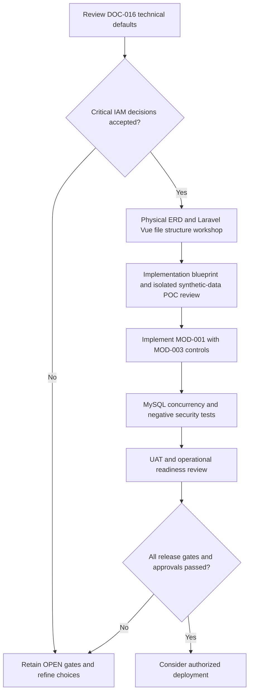

# DOC-016 | P0.7 System Core Technical Readiness & Design Review

> **Version:** v0.1 DRAFT · **Date:** 29 October 2026  
> **Status:** TECHNICAL PLANNING COMPLETE FOR REVIEW; **NOT DEV READY / NOT PRODUCTION READY**  
> **Scope:** MOD-001 User Management; MOD-003 security/audit as a first-class dependency; MOD-002 minimal configuration where approved.  
> **Excluded:** HR Core MOD-004..011 remains HOLD until its own official requirements and approval.  
> **Freeze restriction:** **No physical ERD, Laravel/Vue folder structure, migrations, database table names, server deployment or application code is selected in P0.7.**

## 1. Review input and authority

This checkpoint consolidates:
- [SCOPE-001](../decisions/SCOPE-001_system-core-vs-hr-core.md), [DOC-005 normative DRAFT SRS](../srs/DOC-005_Identity_Access_SRS.md), [RTM](../requirements/RTM.md)
- [DOC-008 Architecture](../architecture/DOC-008_System_Core_Solution_Architecture_v0.1_DRAFT.md), [ADR-006](../decisions/ADR-006_Laravel_Vue_Inertia_MySQL_v0.1_PROPOSED.md)
- [SEC-001 Security](../security/SEC-001_System_Core_Security_Baseline_v0.1_DRAFT.md), [DOC-013 Technical Defaults](../decisions/DOC-013_MOD-001_IAM_Technical_Decisions_v0.1_DRAFT.md), [DOC-014 Contracts](../design/DOC-014_MOD-001_Authentication_Authorization_Contracts_v0.1_DRAFT.md)
- [DOC-015 Logical Model](../data/DOC-015_MOD-001_Logical_Data_Model_v0.1_DRAFT.md), [Data Integrity Test Matrix](../quality/MOD-001_Data_Integrity_Test_Matrix_v0.1_DRAFT.md)
- [DOC-011 Functional Design](../design/DOC-011_MOD-001_Functional_Design_v0.1_DRAFT.md) and [26 functional scenarios](../quality/MOD-001_Functional_Test_Scenarios_v0.1_DRAFT.md) have been consolidated into this review branch from Draft PR #1. Neither design nor code has been approved or merged into main.

The requestor has selected **Laravel + Vue + MySQL** and delegated technical System Core planning. "ENGINEERING SELECTED" below means an implementation **recommendation for the design baseline**, not HR policy approval. The 12 existing `UM-DEC` remain OPEN until recorded decisions are reviewed and signed off. A GitHub merge alone is not business sign-off.

## 2. Technical defaults recommended by engineering

| Decision | Chosen design baseline | Why / enforceable invariant | Evidence and status |
|---|---|---|---|
| TR-001 | **Laravel + Vue 3 + Inertia 3 + TypeScript** as one modern Laravel application | No unnecessary standalone SPA, browser JWT or duplicated auth boundary | ENGINEERING SELECTED; verify starter-version compatibility before bootstrap |
| TR-002 | MySQL **8.4 LTS candidate** for system-data persistence | Stable InnoDB semantics, relational constraints, auditable integration tests | CANDIDATE; hosting/patch support to verify |
| TR-003 | **Username** as primary login key, independent from employee number/email | Support account creation without HR records | ENGINEERING SELECTED; exact format/rename/scope still OPEN |
| TR-004 | Canonical username comparison + **database-enforced uniqueness** | Concurrent creates must not allow duplicate principals | ENGINEERING SELECTED; collation/case/length physical implementation OPEN |
| TR-005 | Initial conceptual roles **System Admin** and **Standard User** only | Minimal privilege boundary; **User Admin** delegation not enabled until grant policy approved | ENGINEERING SELECTED; detailed permission matrix still OPEN |
| TR-006 | Protected **one-time first-admin bootstrap** with no shared/hardcoded credentials | Prevent insecure default administrator and preserve audit provenance | SECURITY DESIGN SELECTED; exact provisioning procedure GATED |
| TR-007 | No public registration; **ACTIVE/INACTIVE** conceptual user states | Minimize unknown onboarding and credential surface | ENGINEERING SELECTED; PENDING_SETUP only if recovery/invite policy requires |
| TR-008 | Laravel server-side **session + CSRF**, secure first-party cookies, session rotation | Avoid browser bearer-token exposure and independent auth subsystem | ENGINEERING SELECTED; cookie/domain/timeout policy pending |
| TR-009 | Prefer **database-backed sessions** and re-check *current* account/role state on every protected operation | DB session storage alone does not invalidate old effective role rights | ENGINEERING SELECTED; all-device revocation mechanism/driver finalization OPEN |
| TR-010 | Per-action/per-target **Laravel authorization**, deny-by-default and input-field allowlists | Hidden Vue controls never grant authority; block mass assignment and IDOR | ENGINEERING SELECTED; specific role grants and review still OPEN |
| TR-011 | **One common transaction-scoped serialization point** for admin-eligibility mutations; no unguarded last-admin count | Concurrent attempts must never leave zero eligible active admins | ENGINEERING SELECTED AT CONCEPT LEVEL; SQL/locking method OPEN and MySQL-tested |
| TR-012 | Redacted, attributable security audit with access restrictions | Preserve actor, action, target, result and time without secrets or unnecessary PII | ENGINEERING SELECTED; immutable storage/retention/visibility OPEN |
| TR-013 | Local password verification with secure adaptive hash, rate limiting and no credential leakage | Resist credential-stuffing, injection and log/prop leaks | ENGINEERING SELECTED; exact auth method/password/MFA policy GATED |
| TR-014 | Privileged MFA required **as proposed production readiness policy**, with reviewed backup/recovery | Security improves only when enrollment and recovery are safe | PRODUCTION GATED; no fake incomplete MFA |
| TR-015 | No speculative `Employee`, `HR Role`, `Department` or multi-tenant model | HR Core requirements have not arrived | SCOPE RECORDED in SCOPE-001 |
| TR-016 | Physical ERD/migrations, source folder structure, Docker topology and hosting **explicitly deferred** | User requested separate design discussion; no assumptions in code | DEFERRED BY REQUEST |

### Critical implementation notes

1. **Username:** propose lowercased ASCII handle with trimmed input and a documented reserved-name policy; final exact charset, case-folding, length and rename behavior must be formally decided before schema/index design.
2. **Auth session:** default database session storage is a practical first design for this application. The app must still enforce active status and *fresh* authorization for each request. A stale Inertia page cannot be a permission cache.
3. **Last-admin concurrency:** do **not** accept `SELECT COUNT(active admins)` outside a synchronized transaction as proof of correctness. All mutations that could change the set of eligible admins must share a serialized consistency boundary (e.g. a common locked governance record or equivalent reviewed design), with deadlock/rollback handling and verified concurrent test cases.
4. **Audit consistency:** specify the failure contract for an audit sink (same-transaction append or reliable outbox) during physical design; an external append-only log cannot be assumed from the conceptual entity.
5. **Credential delivery:** if verified recovery/invite cannot be supported, do not expose reset routes or send passwords over unapproved channels. A system is not ready for real user onboarding merely because login pages render.
6. **Vue:** forms and permission hints are presentation only. Server supplies minimal safe props and validates all inputs. Defer global state store, separate API and SSR until justified.

## 3. Open decisions and accountable review

The following items block final implementation policy and/or production readiness. **No fictional owner approval, effective date, or numeric retention/session SLA is entered.**

| ID | Question / risk | Recommended handling now | Accountable reviewer (proposal) | Affects | Status |
|---|---|---|---|---|---|
| REV-001 | Who may use the system and which organization/username scope? | Assume one System Core instance for design, no tenant column until confirmed | KUTMB IT / management | Q-001, UM-DEC-001, DATA-DEC-001 | OPEN |
| REV-002 | Username syntax, rename rights, minimum account fields, email optionality? | Use minimum stable account identity; no HR fields | IT + requestor | UM-DEC-001/002, DATA-DEC-003/004 | OPEN |
| REV-003 | Initial authorized operator and secure System Admin bootstrap? | One-time protected process; audit and disable bootstrap after success | KUTMB IT authority | UM-DEC-003, DATA-DEC-009 | BLOCKING |
| REV-004 | Which exact permissions and role assignment boundaries? | System Admin + Standard User only; do not activate delegated User Admin | IT/security reviewer | UM-DEC-004/008 | BLOCKING |
| REV-005 | Invitation/initial password and reset delivery/verification? | Leave recovery/activation disabled until approved secure channel and policy | IT + system requestor | UM-DEC-005 | BLOCKING |
| REV-006 | Session idle/absolute timeout, all-device revocation, remember-me? | Server session+CSRF, disable indefinite privileged sessions | IT/security reviewer | UM-DEC-006 | OPEN |
| REV-007 | Privileged MFA enrollment, backup and emergency recovery? | Production privileged login on hold until tested and accepted | IT/security reviewer | UM-DEC-011 | BLOCKING |
| REV-008 | Audit viewer, retention, lawful handling, backup and restore owner? | Keep audit minimal and restricted; no arbitrary retention duration | IT/compliance/HR as relevant | UM-DEC-012, Q-010/011/012 | BLOCKING FOR PRODUCTION |
| REV-009 | UI language/accessibility and supported devices? | BM-first draft, keyboard and responsive; requirements still open | Requestor + IT | UM-DEC-010, Q-014 | OPEN |
| REV-010 | Exact MySQL version, collision/index semantics and last-admin transaction design? | MySQL 8.4 LTS candidate; validate actual runtime and concurrency on MySQL | Developer + IT reviewer | DATA-DEC-002/003/007/009/012 | PHYSICAL-DESIGN REVIEW |
| REV-011 | Physical ERD, Laravel/Vue layout, Docker deploy and backup topology? | Reserve separate workshop; no file tree or migrations | Developer + IT reviewer | DOC-008, DATA-DEC-012 | DEFERRED |
| REV-012 | Security incident response for compromised admin account? | Document authorized emergency recovery, operator verification, evidence and secret rotation before production | IT/security reviewer | UM-DEC-003/011/012 | BLOCKING FOR PRODUCTION |

The existing 12 `UM-DEC` are **still OPEN**; this is a consolidated readiness queue, not a second independent decision authority. Resolve them via the original queue and link approved evidence/ADR/CR.

## 4. Readiness categories

| Area | Design status | Coding approval | Release readiness |
|---|---|---|---|
| Stack family and core boundary | **CONFIRMED DIRECTION** | No app code in this PR | NOT READY |
| Auth/browser transport, account model, RBAC approach | **ENGINEERING SELECTED FOR REVIEW** | Only after identity, bootstrap and role policies reviewed | NOT READY |
| Security baseline and negative test plan | **DRAFT DOCUMENTED** | Tests PLANNED, not executed | NOT READY |
| Account provisioning/reset | **GATED** by verified delivery and identity proof | Do not enable unresolved flow | BLOCKED |
| Privileged MFA and emergency recovery | **GATED** | No live admin release | BLOCKED |
| Audit retention/privacy and backup restore | **GATED** | No production data | BLOCKED |
| Physical ERD/file structure/deployment | **DEFERRED BY REQUEST** | Separate workshop required | NOT READY |
| HR Core modules | **HOLD** | NO | NO |

**Meaning:** The conceptual design is sufficiently developed to conduct a focused review, **not** to declare `DEV READY`, `APPROVED`, UAT PASS or GO-LIVE.

## 5. Proposed next execution order (future work, not performed)

**PR coordination update:** Unique content from Draft PR #1 has been copied into the consolidated Draft PR #2 branch, and shared documentation guidance reconciled. A full reviewer sign-off and merge remain pending. Do **not** treat a merged PR as requirement/business approval.

## 6. Document completeness / traceability snapshot

- 11 module IDs retained; MOD-001..003 = System Core, MOD-004..011 = HR Core HOLD/out of scope.
- 32 existing SRS requirement IDs and 32 AC/test base IDs remain **DRAFT** and unchanged.
- Existing 12 `UM-DEC` and 12 `DATA-DEC` are **OPEN**; this review does not secretly resolve them.
- P0.6 contains 12 proposed logical data invariants and 18 planned test subcases.
- This P0.7 document adds **16 engineering recommendations and 12 review questions only**, **zero normative requirements**, **zero module additions/removals**, **zero executable tests**.
- The v0.3 Excel operational master and CSV mirrors remain unchanged in this PR because their authoritative requirement/module mappings have not been modified. Changes to normative behavior must use a CR and update SRS/RTM/Excel/CSV in the same review.
- Existing release gates remain 0/8 passed. No HR policy decisions are inferred.

## 7. Reference points verified 2026-10-29

- Laravel 13 Vue/Inertia starter: https://laravel.com/docs/13.x/starter-kits
- Laravel 13 session docs: https://laravel.com/docs/13.x/session
- Laravel 13 authorization: https://laravel.com/docs/13.x/authorization
- MySQL 8.4 InnoDB locking reads: https://dev.mysql.com/doc/refman/8.4/en/innodb-locking-reads.html
- MySQL 8.4 transaction isolation: https://dev.mysql.com/doc/refman/8.4/en/innodb-transaction-isolation-levels.html
- NIST SP 800-63B-4 (final, July 2025): https://csrc.nist.gov/pubs/sp/800/63/B/4/final

**Review result: TECHNICAL DESIGN BASELINE PROPOSED, NOT SIGNED OFF.**
